# Fat Fish · PWA del videojuego · Proyecto Integrador

[](https://github.com/Anuma-Games/fat-fish-pwa/actions/workflows/ci.yml)

> **Fase actual:** 1 · Planeación — propuesta de arquitectura
> **Stack de la PWA:** Angular · Service Worker · Web App Manifest
> **Hosting:** Cloud Run (mismo contenedor y mismo origen que el backend)
> **Idioma:** Español
> **Versión del documento:** 0.4 (propuesta de diseño)
> **Fuente de requisitos:** *Recuento final (versión 2): PWA de la integradora*, con los cambios acordados por el equipo
> **Equipo:** Anuma Games (ver [9. Equipo](#9-equipo))

---

## Tabla de contenido

1. [Finalidad de la PWA dentro del proyecto](#1-finalidad-de-la-pwa-dentro-del-proyecto)
2. [Arquitectura](#2-arquitectura)
3. [Modelo de datos](#3-modelo-de-datos)
4. [Consumo de API](#4-consumo-de-api)
5. [Estrategia PWA](#5-estrategia-pwa)
6. [Experiencia de usuario (UI/UX)](#6-experiencia-de-usuario-uiux)
7. [Diagramas de la aplicación](#7-diagramas-de-la-aplicación)
8. [Integración continua y flujo de trabajo](#8-integración-continua-y-flujo-de-trabajo)
9. [Equipo](#9-equipo)

---

## 1. Finalidad de la PWA dentro del proyecto

### 1.1 Resumen y contexto

La PWA es la **cara web del videojuego**: un sitio instalable que permite a los jugadores consultar los datos que el juego genera sobre ellos, ver un ranking mundial, leer una wiki y enviar retroalimentación o una encuesta anónima.

El proyecto es Fat Fish, un videojuego de casino (ruleta, inversiones, fichas especiales, consumibles, jefes y tienda) que, además de entretener, trata el tema del juego de azar y la **ludopatía**. Dentro del juego se usa "invertir" e "inversión", nunca "apostar": no es un juego de apuestas ni usa dinero real. El juego genera datos (partidas, inversiones, pérdidas, duración), pero no es el mejor lugar para analizarlos ni para recibir opiniones. La PWA cubre ese hueco como un **canal web complementario**.

| Aspecto | Decisión |
|---|---|
| Frontend | Angular, PWA con Service Worker y Web App Manifest |
| Arquitectura | N capas |
| Hosting | Cloud Run, en el mismo contenedor que el backend; al compartir origen **no se necesita CORS** |
| Consumo de datos | Solo endpoints `/api/pwa/...` |
| Identidad del jugador | ID único generado por el backend; el alias es público y **puede repetirse**. Se busca por alias o por ID, sin contraseña (provisional hasta usar el inicio de sesión de Steam) |
| Requisito de datos | La PWA **lee** (perfil, historial, ranking) e **inserta** (retroalimentación, encuesta) |
| Idioma | Todo el contenido está en español |

### 1.2 Rol de la PWA

La PWA cierra el ciclo **jugar → registrar → reflexionar → opinar**:

| Rol | Descripción |
|---|---|
| **Espejo de datos** | Muestra al jugador lo que el juego registró de él. La sección *"Lo que el casino sabe de ti"* se presenta como **el perfil que el casino construyó del jugador, no como una lista de logros**. La intención es hacer visibles métricas como total invertido, total perdido o la racha máxima de derrotas. |
| **Competencia social** | Ranking mundial con el mejor puntaje de cada jugador (solo victorias; desempata quien lo logró primero). |
| **Referencia del juego** *(deseable)* | Wiki estática con mecánicas, fichas especiales, consumibles, jefes, tienda y glosario; disponible sin conexión. Se incluye si el tiempo del equipo lo permite. |
| **Canal de voz del usuario** | Formulario de retroalimentación y reporte de errores (categoría + mensaje). |
| **Instrumento de investigación** | Encuesta anónima sobre percepción del juego y la ludopatía, útil para evaluar el impacto del proyecto. |

### 1.3 Qué puede hacer el usuario

- **Buscar su perfil por alias o por ID** (públicos, sin contraseña). Como el alias puede repetirse, los resultados muestran alias **e** ID para elegir el correcto.
- Consultar su **resumen estadístico**: partidas jugadas y ganadas, total invertido, total perdido, racha máxima de derrotas y tiempo jugado.
- Revisar su **historial de partidas** (resultado, ronda alcanzada, puntaje, dinero máximo, invertido y perdido, duración y fecha), paginado.
- Ver el **ranking mundial** (top 50, en páginas de 10) y, si consultó su perfil, **su propia posición**.
- Leer la **wiki** del juego, incluso sin internet *(deseable)*.
- **Enviar retroalimentación** o reportar errores del juego o de la propia PWA.
- Responder la **encuesta anónima**.
- **Instalar** la PWA en el celular o la computadora y usarla como una app.

### 1.4 Alcance y mapa funcional

| Sección | Acceso | Operación | Endpoint que consume |
|---|---|---|---|
| Acceso | Libre | Buscar jugadores por alias o ID | `GET /api/pwa/jugadores` |
| Lo que el casino sabe de ti | **Jugador elegido (ID)** | Leer | `GET /api/pwa/perfil`, `GET /api/pwa/partidas` |
| Ranking mundial | Libre | Leer | `GET /api/pwa/ranking` |
| Wiki *(deseable)* | Libre | Leer (contenido estático dentro de Angular) | — |
| Retroalimentación y reporte de errores | Libre | **Insertar** | `POST /api/pwa/retroalimentacion` |
| Encuesta anónima | Libre | **Insertar** | `POST /api/pwa/encuesta` |

- **Actores:** el *visitante* (sin jugador elegido) accede a todo salvo a las estadísticas; el *jugador identificado* (que eligió su perfil buscando por alias o ID) accede además a su perfil e historial.
- **Fuera de alcance:** la PWA no registra jugadores, partidas ni puntajes (solo los lee), no maneja contraseñas ni el token del juego, no envía notificaciones push y no permite jugar.

### 1.5 Requisitos y dónde se cumplen

| Requisito | Dónde se cumple |
|---|---|
| Vista donde se **ingresa** información | Retroalimentación y encuesta anónima: [6.1](#61-vistas) (pantallas) y [4.3.5](#435-enviar-retroalimentación)–[4.3.6](#436-enviar-encuesta-anónima) (envío a la API) |
| Vista donde se **consulta** información | Búsqueda, expediente (perfil e historial) y ranking: [6.1](#61-vistas) (pantallas) y [4.3.1](#431-buscar-jugadores)–[4.3.4](#434-consultar-ranking) (endpoints) |
| Consumo de API y listas dinámicas | [4. Consumo de API](#4-consumo-de-api) |
| Service Worker, caché y funcionamiento sin conexión | [5. Estrategia PWA](#5-estrategia-pwa) |
| Interfaz modular (JS/CSS) y adaptativa | [6. Experiencia de usuario](#6-experiencia-de-usuario-uiux) |
| Diagramas de la aplicación | [2.1](#21-vista-general), [3](#3-modelo-de-datos), [5.5](#55-cola-de-envío-outbox) y [7](#7-diagramas-de-la-aplicación) |
| Documentación en un `.md` con los integrantes | Este README; [9. Equipo](#9-equipo) |

---

## 2. Arquitectura

### 2.1 Vista general

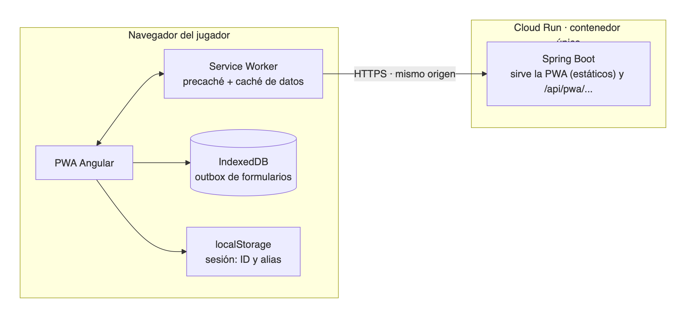

<sub>Código del diagrama: [`docs/diagramas/arquitectura.mmd`](docs/diagramas/arquitectura.mmd)</sub>

### 2.2 Decisiones clave

- **Un solo origen.** El backend sirve el build de Angular como archivos estáticos y expone la API en el mismo dominio. Por eso la PWA usa **rutas relativas** (`/api/pwa/...`) y **no requiere CORS**.
- **Contacto único con el backend.** La PWA solo consume `/api/pwa/**`.
- **Todo el tráfico pasa por el Service Worker**, que decide qué responder desde caché y qué enviar a la red (ver [5. Estrategia PWA](#5-estrategia-pwa)).
- **Desarrollo local.** `ng serve` con un proxy que reenvía `/api` al backend local, de modo que el código siempre usa rutas relativas.
- **Angular moderno:** componentes *standalone* y *signals* para el estado.

### 2.3 Arquitectura en N capas (Angular)

Se organiza **por capa** en el primer nivel y **por sección funcional** dentro de cada capa. Cada capa tiene una única responsabilidad y solo puede depender de la que tiene "hacia adentro".

```
proyecto-pwa/
├── public/                          # manifest.webmanifest, íconos, fuentes (fonts/), patrón de fondo e imágenes de la wiki
├── ngsw-config.json                 # configuración del Service Worker
├── proxy.conf.json                  # proxy de desarrollo hacia /api
├── src/styles/                      # estilos globales y variables de diseño (ver 6.5)
└── src/app/
    │
    ├── presentation/                # ── CAPA 1 · PRESENTACIÓN ──────────────────────
    │   ├── pages/                   # una carpeta por sección (cada una es una ruta)
    │   │   ├── acceso/
    │   │   ├── perfil/              # resumen + historial
    │   │   ├── ranking/
    │   │   ├── wiki/
    │   │   └── opinion/             # retroalimentacion/ y encuesta/ (vistas de captura)
    │   ├── components/              # componentes reutilizables sin lógica de negocio
    │   ├── guards/                  # sesion.guard.ts (protege /perfil)
    │   └── app.routes.ts
    │
    ├── application/                 # ── CAPA 2 · APLICACIÓN (casos de uso) ─────────
    │   └── facades/
    │       ├── sesion.facade.ts             # buscar por alias o ID, elegir jugador, cerrar sesión
    │       ├── perfil.facade.ts             # resumen estadístico
    │       ├── historial.facade.ts          # lista acumulada + paginación
    │       ├── ranking.facade.ts            # top 50 paginado + posición propia
    │       ├── retroalimentacion.facade.ts
    │       ├── encuesta.facade.ts
    │       └── wiki.facade.ts
    │
    ├── domain/                      # ── CAPA 3 · DOMINIO ───────────────────────────
    │   ├── models/                  # Jugador, JugadorResumen, Perfil, Estadisticas, Partida, Pagina<T>,
    │   │                            # Ranking, RankingEntrada, Retroalimentacion, Encuesta,
    │   │                            # ResultadoEnvio
    │   ├── enums/                   # ResultadoPartida, Categoria, Componente
    │   └── repositories/            # PUERTOS: JugadorRepository, PerfilRepository, PartidaRepository,
    │                                # RankingRepository, RetroalimentacionRepository,
    │                                # EncuestaRepository, WikiRepository, SesionRepository
    │
    ├── infrastructure/              # ── CAPA 4 · INFRAESTRUCTURA (datos y plataforma)
    │   ├── api/                     # acceso remoto a /api/pwa
    │   │   ├── dto/                 # DTOs tal como viajan por la red
    │   │   ├── mappers/             # DTO → modelo de dominio
    │   │   └── repositories/        # implementaciones HTTP de los puertos
    │   ├── content/
    │   │   └── wiki/                # contenido estático tipado + WikiEstaticoRepository
    │   ├── storage/                 # SesionStorage (localStorage) y OutboxDb (IndexedDB)
    │   └── pwa/                     # SwUpdateService, InstallPromptService,
    │                                # ConnectivityService, OutboxSyncService
    │
    ├── core/                        # ── TRANSVERSAL (sin lógica de negocio) ────────
    │   └── config/                  # URL base de la API, constantes, tokens de inyección
    │
    ├── app.config.ts                # raíz de composición: router, HttpClient, Service Worker
    │                                # y enlace puerto → implementación
    └── app.component.ts
```

**Rutas:** `/acceso`, `/perfil`, `/ranking`, `/opinion/retroalimentacion`, `/opinion/encuesta` y `/wiki` (deseable). Solo `/perfil` requiere haber elegido un jugador.

**Responsabilidad de cada capa**

| Capa | Responsabilidad | No debe |
|---|---|---|
| **Presentación** | Páginas, componentes, rutas y guards. Solo habla con las **fachadas** | Usar `HttpClient`, `localStorage` ni IndexedDB |
| **Aplicación** | Casos de uso: orquesta el flujo y mantiene el estado con *signals* | Conocer DTOs, HTTP ni mecanismos de almacenamiento |
| **Dominio** | Modelos, enumerados y **puertos** (contratos abstractos) | Depender de Angular HTTP ni de otras capas |
| **Infraestructura** | Implementa los puertos: repositorios HTTP, DTOs, mappers, wiki estática, almacenamiento local y piezas del Service Worker | Contener lógica de presentación |
| **Core** | Configuración transversal | Contener lógica de negocio |

**Reglas de dependencia**

```
presentation  →  application  →  domain  ←  infrastructure
```

- `presentation` nunca importa de `infrastructure`.
- `application` depende solo de los **puertos** de `domain`; no sabe si los datos vienen de HTTP, de caché o de IndexedDB.
- `infrastructure` es la única capa que conoce DTOs, HTTP, `localStorage` e IndexedDB.
- Los puertos se enlazan con sus implementaciones en `app.config.ts` por inyección de dependencias.

**Recorrido de una consulta**

```
Página → Fachada → Puerto (domain) → Repositorio HTTP (infrastructure) → /api/pwa/...
                                                                          │
Página ← Fachada (signal) ← Modelo ← Mapper ← DTO ←──────────────────────┘
```

**Envíos sin conexión.** Los repositorios de escritura (retroalimentación y encuesta) devuelven un `ResultadoEnvio` (`ENVIADO` o `EN_COLA`). Si no hay red, **el propio repositorio** deja la solicitud en el outbox (IndexedDB); la capa de aplicación solo conoce el resultado.

**La wiki como fuente de datos.** Su contenido vive en `infrastructure/content/wiki` como datos tipados dentro del bundle, expuesto mediante `WikiRepository`. Así la wiki sigue el mismo flujo que el resto de las secciones y queda disponible sin conexión por formar parte del precaché.

---

## 3. Modelo de datos

Esquema de referencia sobre el que se construyen los DTOs de la PWA.

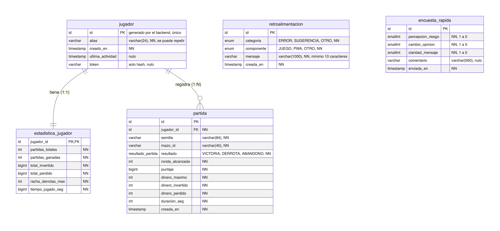

<sub>Código del diagrama: [`docs/diagramas/modelo-datos.mmd`](docs/diagramas/modelo-datos.mmd)</sub>

> `NN` = *not null*. El `id` del jugador lo genera el backend y es lo único que identifica a un jugador; el `alias` se puede repetir, por eso se indexa (sin distinguir mayúsculas) para buscar, pero no es único. `retroalimentacion` y `encuesta_rapida` no tienen relación con `jugador`: la encuesta es anónima y ambas son de solo inserción. Todas las marcas de tiempo se guardan en UTC. Para el ranking existe un índice parcial `(jugador_id, puntaje DESC, creada_en) WHERE resultado = 'VICTORIA'`.

**Cómo usa la PWA cada tabla**

| Tabla | Acceso de la PWA | Columnas que salen en la API | Columnas que nunca salen |
|---|---|---|---|
| `jugador` | Lectura | `id`, `alias`, `creado_en`, `ultima_actividad` | `token` |
| `estadistica_jugador` | Lectura | Todas (incluidas dentro del perfil) | — |
| `partida` | Lectura | `id`, `resultado`, `ronda_alcanzada`, `puntaje`, `dinero_maximo`, `dinero_invertido`, `dinero_perdido`, `duracion_seg`, `creada_en` | `jugador_id`, `semilla`, `mazo_id` |
| `retroalimentacion` | **Inserción** | Entrada: `categoria`, `componente`, `mensaje` | — |
| `encuesta_rapida` | **Inserción** | Entrada: `percepcion_riesgo`, `cambio_opinion`, `claridad_mensaje`, `comentario` | No se devuelve ningún identificador (anonimato) |

La PWA **nunca escribe** en `jugador`, `partida` ni `estadistica_jugador`.

---

## 4. Consumo de API

### 4.1 Principios

1. **Rutas relativas** (`/api/pwa/...`), mismo origen, sin CORS.
2. **JSON en UTF-8**; fechas en **ISO-8601 UTC**; nombres de campo en `camelCase` español.
3. **Los DTOs de red no son los modelos de dominio.** La capa de infraestructura mapea `DTO → modelo`, así un cambio en el contrato solo afecta a los mappers.
4. **Los DTOs se derivan del modelo de datos** (sección 3) y no exponen `token`, `semilla`, `mazo_id` ni `partida.jugador_id`.
5. **La identidad viaja en la URL** (el ID del jugador como query param) en las consultas del jugador. Basta el ID porque es único; el alias solo se usa para buscar. Al ser un dato público es aceptable y además **es necesario para la caché**: el Service Worker usa la URL como llave; si la identidad fuera una cabecera, un usuario podría recibir datos cacheados de otro en el mismo dispositivo.
6. Las rutas son **sugeridas**; el contrato definitivo se fija en el diseño detallado.

### 4.2 Equivalencia de tipos y DTOs comunes

| BD (PostgreSQL) | TypeScript / JSON | Nota |
|---|---|---|
| `id` (`bigint`) | `string` | Número consecutivo generado por el backend (no lo genera el cliente), p. ej. `"1042"`. Viaja como texto con solo dígitos para no perder precisión |
| `varchar(n)` | `string` | Se respeta la longitud máxima |
| `int`, `smallint` | `number` | |
| `bigint` | `number` | Aplica a `puntaje`, `total_invertido`, `total_perdido` y `tiempo_jugado_seg`. Se asume que no superan `Number.MAX_SAFE_INTEGER` (2⁵³ − 1) |
| `timestamp` | `string` | ISO-8601 en UTC |
| `enum` | unión de literales | p. ej. `'VICTORIA' \| 'DERROTA' \| 'ABANDONO'` |

```ts
// infrastructure/api/dto/comun.dto.ts

/** Respuesta paginada */
export interface PaginaDto<T> {
  contenido: T[];
  pagina: number;          // base 0
  tamano: number;
  totalElementos: number;
  totalPaginas: number;
  ultima: boolean;
  generadoEn: string;      // momento en que el servidor generó la respuesta (ISO-8601 UTC)
}
```

> `generadoEn` permite indicar la antigüedad de los datos cuando se sirven desde la caché sin conexión (ver [5.4](#54-qué-pasa-con-los-puntajes-si-se-pierde-la-conexión)).

### 4.3 Endpoints consumidos por la PWA

#### 4.3.1 Buscar jugadores

`GET /api/pwa/jugadores?busqueda={texto}`

Busca jugadores por **alias o por ID**. Como el alias puede repetirse, devuelve una lista; cada resultado incluye alias **e** ID para que el usuario elija el correcto.

| Parámetro | Tipo | Obligatorio | Origen y reglas |
|---|---|---|---|
| `busqueda` | string | Sí | Si son solo dígitos, se busca por `jugador.id` (exacto). Si no, por `jugador.alias` (3 a 24 caracteres, coincidencia exacta sin distinguir mayúsculas) |

**Tabla:** `jugador`. **Orden:** coincidencia por ID primero; después por `ultima_actividad` descendente. Máximo 20 resultados. Sin resultados responde `200` con una lista vacía; la PWA muestra "No encontramos a ningún jugador con ese alias o ID", sin indicar qué dato falló.

```ts
// infrastructure/api/dto/jugador.dto.ts
export interface JugadorResumenDto {
  jugadorId: string;               // jugador.id · id · único
  alias: string;                   // jugador.alias · varchar(24) · puede repetirse
  ultimaActividad: string | null;  // jugador.ultima_actividad · nulo
}
// Respuesta: JugadorResumenDto[]
```

Al elegir un resultado, `SesionFacade` guarda el ID y el alias del jugador para reutilizarlos en el perfil, el historial y el ranking.

#### 4.3.2 Consultar perfil

`GET /api/pwa/perfil?id={id}`

Devuelve los datos básicos del jugador (alias, fecha de alta y última actividad) junto con sus seis métricas estadísticas.

| Parámetro | Tipo | Obligatorio | Origen y reglas |
|---|---|---|---|
| `id` | string (id) | Sí | `jugador.id` (obtenido de la búsqueda) |

**Tablas:** `jugador` + `estadistica_jugador` (1:1, se entrega anidada).

```ts
// infrastructure/api/dto/perfil.dto.ts
export interface EstadisticasDto {
  partidasTotales: number;     // estadistica_jugador.partidas_totales  · int
  partidasGanadas: number;     // estadistica_jugador.partidas_ganadas  · int
  totalInvertido: number;      // estadistica_jugador.total_invertido   · bigint
  totalPerdido: number;        // estadistica_jugador.total_perdido     · bigint
  rachaDerrotasMax: number;    // estadistica_jugador.racha_derrotas_max · int
  tiempoJugadoSeg: number;     // estadistica_jugador.tiempo_jugado_seg · bigint
}

export interface PerfilDto {
  jugadorId: string;               // jugador.id · id
  alias: string;                   // jugador.alias · varchar(24)
  creadoEn: string;                // jugador.creado_en
  ultimaActividad: string | null;  // jugador.ultima_actividad · nulo
  estadisticas: EstadisticasDto;
  generadoEn: string;
}
```

Si el ID no existe, responde `404` con el mensaje genérico de "no se encontró".

#### 4.3.3 Consultar historial de partidas

`GET /api/pwa/partidas?id={id}&pagina=0&tamano=10`

Devuelve las partidas del jugador, de la más reciente a la más antigua, en páginas.

| Parámetro | Tipo | Obligatorio | Origen y reglas |
|---|---|---|---|
| `id` | string (id) | Sí | `jugador.id` |
| `pagina` | int | No | Base 0; por defecto `0` |
| `tamano` | int | No | Por defecto `10`; máximo `50` |

**Tabla:** `partida`, filtrada por el jugador. **Orden fijo:** `creada_en` descendente.

```ts
// infrastructure/api/dto/partida.dto.ts
export type ResultadoPartidaDto = 'VICTORIA' | 'DERROTA' | 'ABANDONO';

export interface PartidaDto {
  id: string;                      // partida.id · id
  resultado: ResultadoPartidaDto;  // partida.resultado · enum resultado_partida
  rondaAlcanzada: number;          // partida.ronda_alcanzada · int
  puntaje: number;                 // partida.puntaje · bigint
  dineroMaximo: number;            // partida.dinero_maximo · int
  dineroInvertido: number;         // partida.dinero_invertido · int
  dineroPerdido: number;           // partida.dinero_perdido · int
  duracionSeg: number;             // partida.duracion_seg · int
  creadaEn: string;                // partida.creada_en
}
// Respuesta: PaginaDto<PartidaDto>
```

El DTO **no incluye** `jugador_id`, `semilla` ni `mazo_id`. `HistorialFacade` mantiene la lista acumulada y, con el botón **Ver más partidas**, solicita la página siguiente mientras `ultima` sea `false`.

#### 4.3.4 Consultar ranking

`GET /api/pwa/ranking?pagina=0&tamano=10&jugadorId={id}`

Devuelve una página del ranking mundial (10 jugadores por página, hasta el lugar 50: 5 páginas) y, si se envía el ID del jugador, también su posición, que la PWA deja fija en pantalla al cambiar de página. Es de acceso libre.

| Parámetro | Tipo | Obligatorio | Origen y reglas |
|---|---|---|---|
| `pagina` | int | No | Base 0; por defecto `0`; máximo `4` |
| `tamano` | int | No | Por defecto y máximo `10` |
| `jugadorId` | string (id) | No | `jugador.id`. Si se envía, la respuesta incluye `miPosicion` |

**Tablas:** `partida` + `jugador`.

**Regla:** por cada jugador se toma su **mejor `puntaje`** entre las partidas con `resultado = 'VICTORIA'`; se ordena por puntaje descendente y, ante empate, por `creada_en` ascendente (**quien lo logró primero**). El ranking llega hasta el lugar 50.

```ts
// infrastructure/api/dto/ranking.dto.ts
export interface RankingEntradaDto {
  posicion: number;      // calculada por el servidor (no es una columna)
  jugadorId: string;     // jugador.id · distingue a jugadores con el mismo alias
  alias: string;         // jugador.alias
  puntaje: number;       // partida.puntaje · bigint (el mejor de sus victorias)
  logradoEn: string;     // partida.creada_en de esa partida
}

export interface RankingDto {
  pagina: PaginaDto<RankingEntradaDto>;   // 10 por página, máximo 5 páginas
  miPosicion: RankingEntradaDto | null;   // null si no se envió jugadorId o no tiene victorias
}
```

#### 4.3.5 Enviar retroalimentación

`POST /api/pwa/retroalimentacion`

**Tabla:** `retroalimentacion` (solo inserción). Responde `201` con el `id` generado por el servidor y la fecha de creación.

```ts
// infrastructure/api/dto/retroalimentacion.dto.ts
export type CategoriaDto = 'ERROR' | 'SUGERENCIA' | 'OTRO';
export type ComponenteDto = 'JUEGO' | 'PWA' | 'OTRO';

export interface RetroalimentacionRequestDto {
  categoria: CategoriaDto;     // retroalimentacion.categoria · enum · NN
  componente: ComponenteDto;   // retroalimentacion.componente · enum · NN (dónde ocurrió)
  mensaje: string;             // retroalimentacion.mensaje · varchar(1000) · NN · mínimo 10 caracteres
}

export interface RetroalimentacionResponseDto {
  id: string;                  // retroalimentacion.id · id · lo genera el servidor
  creadaEn: string;            // retroalimentacion.creada_en
}
```

#### 4.3.6 Enviar encuesta anónima

`POST /api/pwa/encuesta`

**Tabla:** `encuesta_rapida` (anónima, solo inserción). Responde `201` solo para confirmar la recepción; **no devuelve ningún identificador**.

```ts
// infrastructure/api/dto/encuesta.dto.ts
export interface EncuestaRequestDto {
  percepcionRiesgo: number;    // encuesta_rapida.percepcion_riesgo · smallint · NN · 1 a 5
  cambioOpinion: number;       // encuesta_rapida.cambio_opinion    · smallint · NN · 1 a 5
  claridadMensaje: number;     // encuesta_rapida.claridad_mensaje  · smallint · NN · 1 a 5
  comentario?: string | null;  // encuesta_rapida.comentario        · varchar(500) · opcional
}

export interface EncuestaResponseDto {
  recibida: true;
  enviadaEn: string;           // encuesta_rapida.enviada_en
}
```

| Campo | Qué mide |
|---|---|
| `percepcionRiesgo` | Qué tan riesgosos considera los juegos de azar |
| `cambioOpinion` | Si el juego cambió su percepción |
| `claridadMensaje` | Qué tan claro fue el mensaje de responsabilidad social |

**Anonimato:** la petición no lleva alias, ID, token ni datos de sesión, y el outbox tampoco los guarda.

### 4.4 Flujo de consumo en Angular

Todas las secciones siguen el mismo recorrido. Se describe con el ranking como ejemplo:

1. **La página** (presentación) solicita los datos a su fachada al abrirse. Nunca llama a HTTP directamente.
2. **La fachada** (aplicación) trabaja con el puerto `RankingRepository`, definido en el dominio. Si hay una sesión activa, incluye el ID del jugador para obtener también su posición.
3. **El repositorio HTTP** (infraestructura) hace la petición `GET` a la ruta relativa `/api/pwa/ranking`, con la página solicitada (10 jugadores) y, opcionalmente, el ID del jugador.
4. **La respuesta** llega como `RankingDto` y el mapper la convierte al modelo de dominio `Ranking`.
5. **La fachada** guarda el resultado en una *signal* y mantiene otra que indica si la carga está en curso.
6. **La página** lee esas signals y pinta la lista de forma dinámica: una fila por cada jugador de la página, la paginación (hasta el lugar 50), un mensaje cuando no hay registros y, fija abajo, la posición del propio jugador.
7. **El enlace entre puertos e implementaciones** se declara una sola vez en `app.config.ts`: cada puerto del dominio apunta a su implementación en infraestructura (repositorios HTTP, wiki estática o almacenamiento local de la sesión).

**Qué usa cada sección**

| Sección | Fachada | Puerto (dominio) | Fuente de datos | Qué se renderiza |
|---|---|---|---|---|
| Acceso | `SesionFacade` | `JugadorRepository`, `SesionRepository` | `GET /api/pwa/jugadores` + `localStorage` | Lista de coincidencias (alias + ID) |
| Perfil | `PerfilFacade` | `PerfilRepository` | `GET /api/pwa/perfil` | Resumen estadístico |
| Historial | `HistorialFacade` | `PartidaRepository` | `GET /api/pwa/partidas` | Lista paginada y acumulada |
| Ranking | `RankingFacade` | `RankingRepository` | `GET /api/pwa/ranking` | Top 50 en páginas de 10 y posición propia fija |
| Wiki | `WikiFacade` | `WikiRepository` | Contenido estático local | Secciones de la wiki |
| Retroalimentación | `RetroalimentacionFacade` | `RetroalimentacionRepository` | `POST /api/pwa/retroalimentacion` (o outbox) | Confirmación de envío |
| Encuesta | `EncuestaFacade` | `EncuestaRepository` | `POST /api/pwa/encuesta` (o outbox) | Confirmación de envío |

**Particularidades**

- **Historial:** la fachada conserva la lista acumulada y, cada vez que el usuario pulsa **Ver más partidas**, solicita la página siguiente y la agrega, hasta que la API indica que es la última (entonces el botón desaparece).
- **Formularios:** la fachada valida los campos (longitudes y rangos del modelo de datos) y llama al repositorio, que intenta enviar por HTTP. Si no hay red, el repositorio guarda la solicitud en el outbox y devuelve `EN_COLA`; la fachada solo comunica si quedó `ENVIADO` o `EN_COLA`.
- **Sesión:** cuando el usuario elige un jugador en los resultados de búsqueda, la fachada de sesión guarda su ID y alias en `localStorage` para que las demás secciones y el modo sin conexión puedan reutilizarlos.

---

## 5. Estrategia PWA

La PWA se apoya en dos piezas: el **manifiesto**, que permite instalarla, y el **Service Worker**, que da soporte sin conexión y trabajo en segundo plano. Se usa el Service Worker oficial de Angular (`@angular/service-worker`).

### 5.1 Manifiesto

El archivo `manifest.webmanifest` (generado con `ng add @angular/pwa` y ajustado) describe la app para que el navegador pueda instalarla.

| Propiedad | Valor propuesto |
|---|---|
| Nombre y nombre corto | "Fat Fish · Lo que el casino sabe de ti" y "Fat Fish" |
| Descripción | Consulta tus estadísticas y el ranking mundial, y danos tu opinión sobre el juego |
| Idioma | Español |
| Modo de visualización | `standalone` (se abre como una app, sin barra del navegador) |
| Inicio y alcance | `/` en ambos |
| Íconos | Logo del juego en 192×192 y 512×512, más una versión *maskable* de 512×512 sobre `#0B1416` |
| Accesos directos | Mi perfil, Ranking y Opinión (y Wiki, si se incluye) |
| Colores | `theme_color` y `background_color`: `#0B1416` (fondo del casino; ver [6.2](#62-colores)) |

### 5.2 Service Worker y estrategia de caché

El Service Worker se configura de forma declarativa en `ngsw-config.json`. Solo se activa en producción y requiere HTTPS (Cloud Run lo provee). Maneja dos tipos de recursos:

- **Archivos de la app** (código y wiki): se descargan por adelantado al instalar el Service Worker (*precaché*), así la app abre sin red. Incluye las imágenes de la wiki.
- **Respuestas de la API** (`GET`): estrategia **red primero**. Se intenta la red y, si falla o tarda más de 5 segundos, se responde con la última respuesta guardada.

| Recurso | Estrategia | Vigencia |
|---|---|---|
| Código de la app y wiki | Precaché | Hasta la siguiente versión |
| Búsqueda de jugadores | Red primero | 1 día |
| Ranking | Red primero | 1 día |
| Perfil | Red primero | 7 días |
| Historial | Red primero | 7 días (solo las páginas ya visitadas) |
| Envíos (`POST`) | Sin caché; cola propia | — |

Puntos a tener en cuenta:
- Los `POST` nunca se cachean; por eso los formularios usan una cola propia (ver [5.5](#55-cola-de-envío-outbox)).
- Las rutas de la API se excluyen de la navegación del Service Worker para que nunca se respondan con la página principal.
- Los patrones de URL se verifican con la página de depuración `/ngsw/state`, para confirmar que cubren los parámetros de consulta.

### 5.3 Comportamiento sin conexión por sección

| Sección | Sin conexión | Mecanismo |
|---|---|---|
| Wiki | ✅ Completa | Contenido dentro del bundle + precaché |
| Acceso (primera búsqueda) | ❌ Requiere red | La búsqueda es contra la base de datos |
| Acceso (sesión previa) | ✅ Se reabre | ID y alias del jugador elegido guardados en `localStorage` |
| Perfil e historial | ⚠️ Últimos datos consultados | Caché del Service Worker; si nunca se consultaron, se avisa que se necesita red |
| Ranking | ⚠️ Último ranking consultado | Caché del Service Worker |
| Retroalimentación y encuesta | ✅ Se capturan y se encolan | Outbox en IndexedDB |

> **Supuesto del recuento:** la wiki queda disponible sin conexión y las estadísticas muestran un aviso si no hay red. Esta propuesta lo **amplía**: además del aviso, se conservan los últimos datos consultados indicando su fecha de actualización. Queda por validar.

### 5.4 ¿Qué pasa con los puntajes si se pierde la conexión?

Los puntajes tienen tres momentos, cada uno con su propia protección:

- **Cuando se generan.** La PWA nunca escribe partidas ni puntajes: los envía el videojuego, que los conserva en su cola local hasta recuperar la conexión. Por eso una partida jugada sin red aparece en la PWA (historial, estadísticas y ranking) hasta que el juego la sincronice. Es consistencia eventual.
- **Cuando se consultan en la PWA.** Si el usuario ya había abierto su perfil, su historial o el ranking y pierde la conexión, **esos datos siguen disponibles** gracias a la caché del Service Worker. La PWA avisa que está sin conexión y muestra la fecha de la última actualización (`generadoEn`). Al volver la red, la siguiente consulta los refresca. Si nunca se habían consultado, se avisa que se necesita conexión.
- **Cuando el usuario envía algo.** La retroalimentación y la encuesta se guardan en el dispositivo y se envían solas al reconectar (ver 5.5).

| Dato | Dónde queda si no hay red | Cuándo se sincroniza |
|---|---|---|
| Partida y puntaje nuevos | Cola local del videojuego | Cuando el juego recupera conexión |
| Perfil, historial y ranking consultados | Caché del Service Worker | En la siguiente consulta con red |
| Retroalimentación y encuesta pendientes | Outbox (IndexedDB) | Al reconectar, al abrir la app o por Background Sync |
| Sesión (ID y alias) | `localStorage` | No aplica (solo local) |
| Wiki | Precaché | Con cada nueva versión de la app |

**Ejemplo:** Ana termina una partida en el metro, sin red; el juego la guarda. Abre la PWA y consulta el ranking que vio hace dos horas, marcado como "sin conexión". Llena la encuesta y queda pendiente de envío. Al llegar a casa recupera la red: el juego envía la partida y la PWA envía la encuesta. Cuando Ana abre su perfil, ya ve la partida reflejada.

### 5.5 Cola de envío (Outbox)

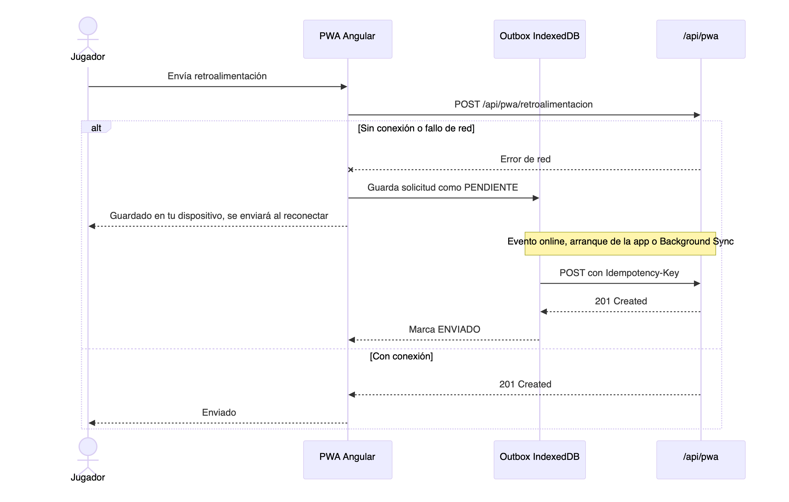

<sub>Código del diagrama: [`docs/diagramas/outbox.mmd`](docs/diagramas/outbox.mmd)</sub>

Cada registro del outbox guarda un identificador único generado en el dispositivo, el tipo de envío (retroalimentación o encuesta), el contenido, la fecha, el número de intentos y su estado (pendiente, enviando, enviado o fallido).

- **Se encola** cuando el envío falla por falta de red.
- **Se vacía** al recuperar la conexión, al abrir la app, al volver a primer plano y, donde existe, con Background Sync.
- **Reintentos** con espera creciente hasta un máximo de intentos o de días; después el registro pasa a *fallido*.
- **Sin duplicados:** cada envío lleva una cabecera `Idempotency-Key` con el identificador del registro, de modo que un reintento no genere un duplicado. Requiere soporte del backend (mejora recomendada).
- **Anonimato:** el outbox de la encuesta no guarda alias, ID ni ningún dato personal.

### 5.6 Segundo plano y actualizaciones

- **Segundo plano.** El Service Worker vive aparte de la página y se aprovecha para el precaché, la detección de versiones nuevas y, como *mejora progresiva*, **Background Sync**, que vacía el outbox aunque la pestaña ya esté cerrada. Background Sync solo existe en Chromium; en Safari y Firefox el respaldo es vaciar la cola al reconectar, al abrir la app o al volver a primer plano. Las notificaciones push y la sincronización periódica quedan fuera de alcance.
- **Actualizaciones.** La PWA revisa si hay una versión nueva al iniciar y periódicamente (p. ej. cada 6 horas). Cuando la descarga está lista, avisa al usuario y, si acepta, activa la versión y recarga.
- **Almacenamiento persistente.** Se solicita al navegador para reducir el riesgo de que purgue la caché o IndexedDB.

### 5.7 Hosting y limitaciones

Como Angular se sirve desde el mismo contenedor que el backend, el servidor debe cumplir tres condiciones:

1. **Responder `index.html` ante las rutas de Angular** (`/ranking`, `/perfil`…) cuando el usuario las abre directamente o recarga, sin interferir con `/api/**`.
2. **No cachear los archivos de control** (`index.html`, `ngsw.json`, `ngsw-worker.js`, `manifest.webmanifest`), para que las actualizaciones lleguen, y dar caché larga e inmutable a los bundles con hash.
3. **Servir el Service Worker desde la raíz** (`/`) para que controle toda la app.

---

## 6. Experiencia de usuario (UI/UX)

La PWA se ve como el casino clandestino del juego: fondo oscuro con un patrón de rombos muy sutil (15 % de opacidad), paño verde, detalles dorados y letras pixeladas. Colores, fuentes y logo salen del arte del juego en Unity, así quien pasa del juego a la PWA reconoce el mismo lugar. El dorado se usa poco (solo para señalar lo importante) para que la app no se sienta cargada.

### 6.1 Vistas

**Vistas de consulta:** buscar un jugador, su expediente (estadísticas e historial) y el ranking. El menú se abre con el botón ☰ en el teléfono.

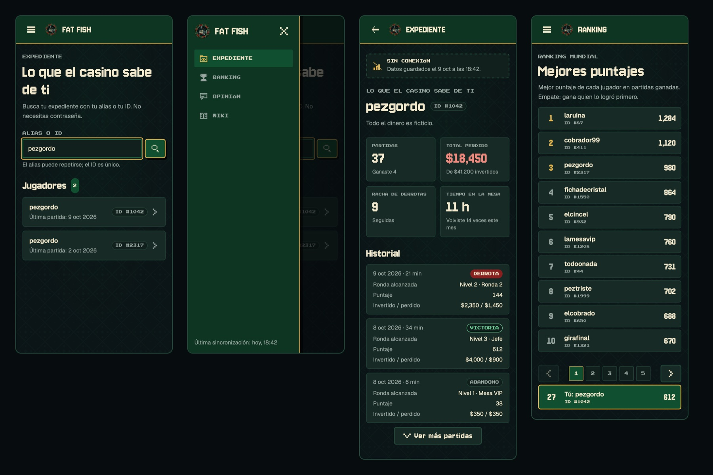

**Vistas de captura:** retroalimentación y encuesta anónima. Sin conexión, el envío se guarda en el dispositivo y se manda solo al volver la red ([5.5](#55-cola-de-envío-outbox)).

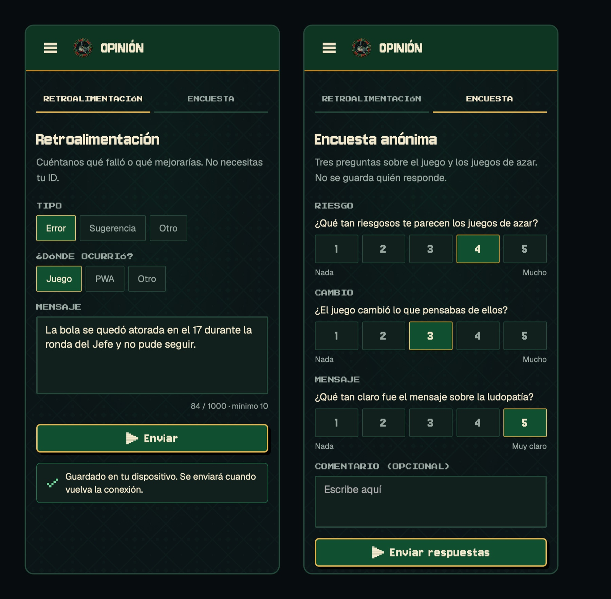

### 6.2 Colores

| Nombre | Color | Uso |
|---|---|---|
| `bg-900` | `#0B1416` | Fondo de la app, con el patrón [`patron-casino.svg`](docs/img/patron-casino.svg) encima |
| `bg-800` / `bg-700` | `#11201C` / `#172A25` | Campos de texto / tarjetas |
| `felt-800` | `#0D3522` | Menú lateral y barra superior (paño oscuro) |
| `felt-700` | `#105030` | Botón principal, opción elegida y sección activa |
| `line` | `#24493A` | Bordes y divisores |
| `gold-400` / `gold-600` | `#E8B850` / `#C08828` | Ícono activo, foco del teclado, top 3 del ranking / borde del menú |
| `ruby-700` / `ruby-300` | `#882020` / `#F08A7E` | Ficha DERROTA y botón de peligro / errores y pérdidas |
| `cream-100` / `fog-400` | `#F2E8CC` / `#9AA8A2` | Texto principal / texto secundario |
| `win-300` | `#6FD39A` | Ficha VICTORIA y confirmaciones |

Todos los textos tienen buen contraste con su fondo para leerse con facilidad, también en pantallas con poco brillo. El resultado de una partida siempre se escribe (VICTORIA, DERROTA, ABANDONO), no se indica solo con color.

### 6.3 Tipografía y espaciado

| Uso | Fuente |
|---|---|
| Títulos, cifras y botones | **Jersey 10**, la fuente de los botones del juego |
| Etiquetas cortas (IDs, encabezados de tabla, menú) | **Press Start 2P**, a 9–10 px y en mayúsculas |
| Todo lo que se lee (párrafos, ayudas, tablas) | **Geist**, legible y parecida a la Geist Pixel del juego |

- Las fuentes se guardan en `public/fonts/` para que funcionen sin conexión.
- **Espaciado** en múltiplos de 4 px (4, 8, 12, 16, 24 y 32), como los sprites del juego.
- **Esquinas** casi rectas: 2 px en campos y 6 px en tarjetas y botones; las fichas son redondas.
- **Sombras** duras, sin difuminar (4 px), como en el pixel art.

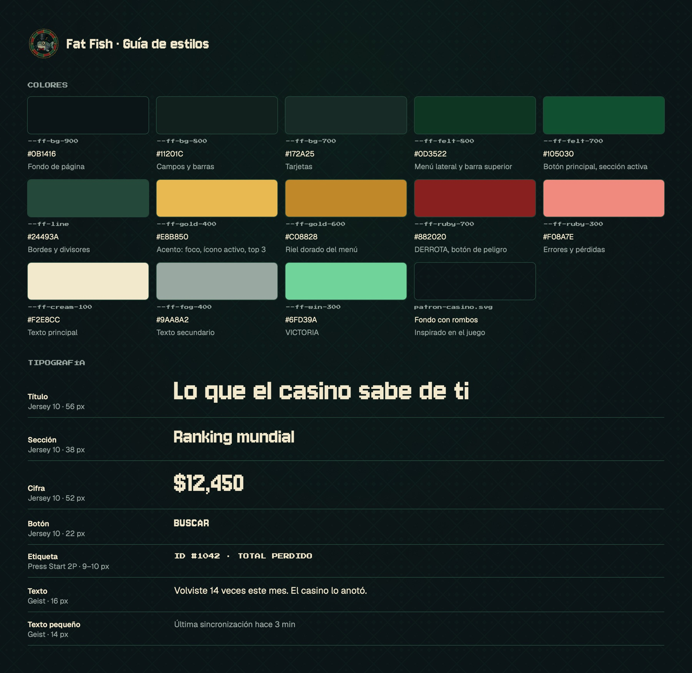

### 6.4 Componentes e íconos

Piezas reutilizables en `presentation/components/`: botón, campo de búsqueda, resultado de jugador (alias + ID), ficha de estado, tarjeta de estadística, historial con **Ver más partidas**, fila del ranking con paginación, aviso "Sin conexión", menú lateral y, para los formularios, opción única, escala del 1 al 5, texto largo con contador y aviso de "guardado en tu dispositivo".

- Los botones usan íconos cuando la acción es obvia (buscar, volver, página anterior y siguiente) y siempre llevan una descripción para lectores de pantalla.
- Los íconos son pixel art de 12 × 12 hechos para la PWA y toman el color del texto.
- Botones, opciones y enlaces miden al menos 44 px para tocarse con el dedo.

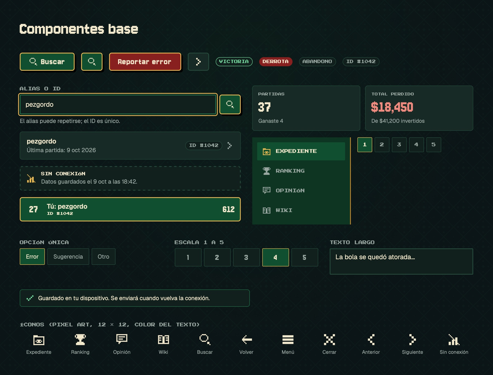

### 6.5 Estructura modular (CSS y JavaScript)

```
src/
├── styles.css            # solo importa los archivos de styles/
└── styles/
    ├── tokens.css        # colores, fuentes y espacios (variables --ff-*)
    ├── base.css          # estilos generales y fondo con patrón
    └── layout.css        # menú lateral, márgenes y puntos de quiebre
src/app/presentation/components/
└── stat-card/            # cada componente con su .ts, .html y .css
```

- Los valores (colores, tamaños, espacios) solo se escriben en `tokens.css`; los componentes usan `var(--ff-*)`. Cambiar un color es editar un solo archivo.
- Cada componente tiene sus propios estilos (Angular los encapsula).
- El JavaScript (TypeScript) sigue las capas de la sección 2.3: los componentes solo muestran datos; la lógica vive en las fachadas.

### 6.6 Diseño adaptativo

Se diseña primero para teléfono y se amplía:

| Ancho | Cambios |
|---|---|
| Teléfono (menos de 768 px) | Una columna. El menú se abre con el botón ☰. El historial se muestra en tarjetas |
| Tableta (768 px o más) | Estadísticas en 4 columnas, historial en tabla y los dos formularios de Opinión lado a lado |
| Escritorio (1024 px o más) | Menú lateral siempre visible y contenido de 1040 px como máximo |

En el ranking, la posición del jugador queda fija abajo mientras se cambia de página.

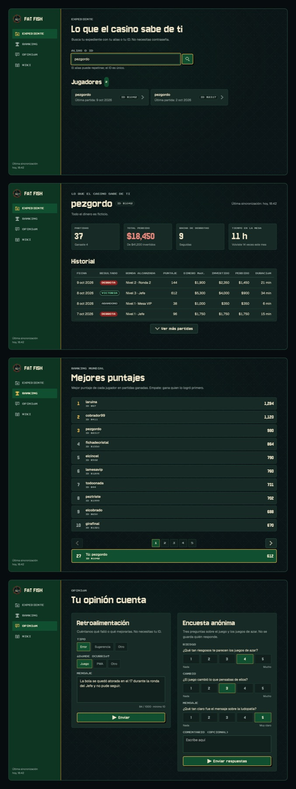

### 6.7 Textos

- Todo en español y de **tú**: "Volviste 14 veces este mes".
- En la mecánica del juego se dice **invertir**, nunca "apostar".
- El expediente describe hechos, sin felicitar: es parte del mensaje sobre la ludopatía.
- Los montos son dinero ficticio y la pantalla lo aclara.
- Los errores dicen qué pasó y cómo seguir; una búsqueda sin resultados no dice qué dato falló.

---

## 7. Diagramas de la aplicación

Complementan los diagramas de las secciones 2.1, 3 y 5.5. Todos se muestran como imagen para que se vean igual en GitHub y en cualquier editor; su código está en [`docs/diagramas/`](docs/diagramas).

### 7.1 Contexto del sistema

Cómo llegan los datos del juego a la PWA.

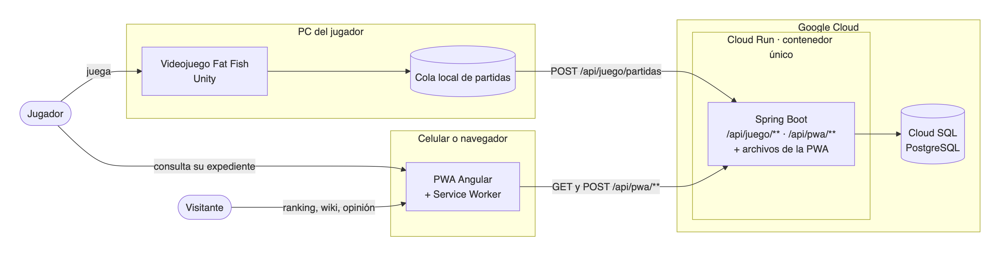

### 7.2 Mapa de navegación

Rutas de la PWA y si cada vista es de consulta o de captura. Solo el expediente necesita haber elegido un jugador; lo demás es libre.

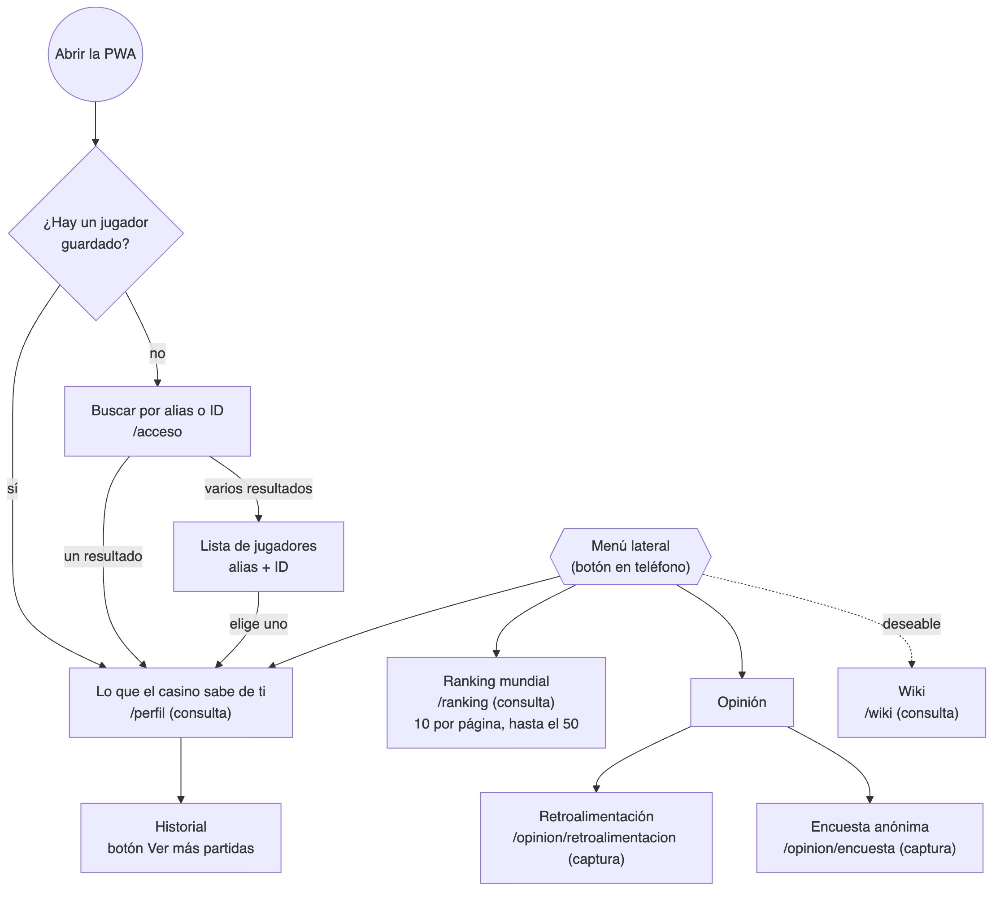

### 7.3 Buscar un jugador y ver su expediente

Como el alias puede repetirse, la búsqueda devuelve una lista y el jugador elige por ID (endpoint [4.3.1](#431-buscar-jugadores)).

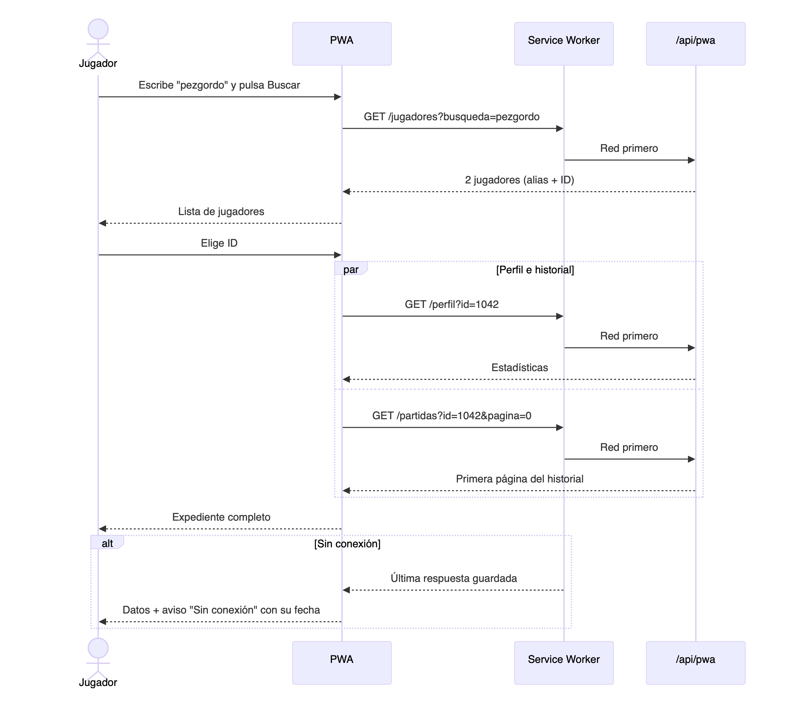

### 7.4 Estados de una pantalla

Perfil, historial y ranking muestran siempre en qué estado están: cargando, con datos, vacío, sin conexión o con error.

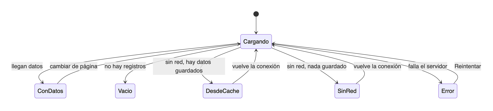

### 7.5 Service Worker

Cómo se instala la PWA, cómo atiende sin red y cómo se actualiza.

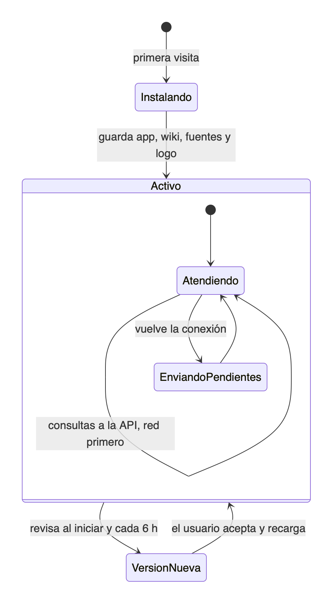

---

## 8. Integración continua y flujo de trabajo

El workflow [`.github/workflows/ci.yml`](.github/workflows/ci.yml) corre en cada push a `main` y `develop` y en cada Pull Request hacia esas ramas:

1. **Analizar y probar:** formato del código (`npm run format:check`) y pruebas (`ng test`).
2. **Compilar** (solo si el paso anterior pasa): `ng build` y sube el resultado como artefacto `fat-fish-pwa-dist`.

- Ramas: `main` (producción), `develop` (integración) y `feature/FF-<ticket>-<descripcion>`; ambas ramas principales están protegidas.
- Todo cambio entra por Pull Request con una aprobación y el CI en verde. `CODEOWNERS` asigna revisores y la plantilla de PR pide el ticket de Jira.
- Dependabot revisa cada semana las dependencias (npm y acciones de GitHub) y abre PRs hacia `develop`.

---

## 9. Equipo

**Anuma Games**, Proyecto integrador, grupo IDGS101N, Universidad Tecnológica de Chihuahua.

| Integrante |
|---|
| Luis Ángel Gaxiola Gamboa |
| Emmanuel González Hernández |
| Jesús Antonio Jiménez Mendoza |
| Ángel Gael Jurado Rodríguez |
| Andrik Rivera Esquer |
