# Fat Fish – PWA del videojuego

[](https://github.com/Anuma-Games/fat-fish-pwa/actions/workflows/ci.yml)

Aplicación web progresiva (PWA) del proyecto integrador **Fat Fish**, del equipo Anuma Games (IDGS101N, Universidad Tecnológica de Chihuahua). Está hecha con Angular, un Service Worker y un manifiesto de aplicación web, y se conecta a la API del proyecto ([fat-fish-api](https://github.com/Anuma-Games/fat-fish-api)).

La PWA está publicada en Firebase Hosting y es de acceso público: <https://fat-fish-511723.web.app> (dirección predeterminada alterna: <https://fat-fish-511723.firebaseapp.com>).

Este documento reúne la **propuesta de diseño** de la PWA y el **estado actual** de su construcción. Las pruebas de integración con la base de datos están en el [laboratorio de pruebas](docs/laboratorio-pruebas/README.md).

## Contenido

1. [Propósito](#1-propósito)
2. [Estado actual](#2-estado-actual)
3. [Cómo ejecutarla](#3-cómo-ejecutarla)
4. [Arquitectura](#4-arquitectura)
5. [Modelo de datos](#5-modelo-de-datos)
6. [Consumo de API](#6-consumo-de-api)
7. [Estrategia PWA](#7-estrategia-pwa)
8. [Experiencia de usuario (UI/UX)](#8-experiencia-de-usuario-uiux)
9. [Diagramas de la aplicación](#9-diagramas-de-la-aplicación)
10. [Integración continua y flujo de trabajo](#10-integración-continua-y-flujo-de-trabajo)
11. [Equipo](#11-equipo)

### Dónde se cumple cada requisito

| Actividad                | Requisito                                                  | Sección                                                                                                                   |
|--------------------------|------------------------------------------------------------|---------------------------------------------------------------------------------------------------------------------------|
| Diseño preproyecto       | Consumo de API y listas dinámicas                          | [6](#6-consumo-de-api)                                                                                                    |
| Diseño preproyecto       | Service Worker y manifiesto (sin conexión y segundo plano) | [7](#7-estrategia-pwa)                                                                                                    |
| Diseño preproyecto       | Estructura modular (JS/CSS) y diseño adaptativo            | [4.2](#42-capas-del-código) y [8](#8-experiencia-de-usuario-uiux)                                                         |
| Diseño preproyecto       | Diagramas de la aplicación                                 | [4](#4-arquitectura), [5](#5-modelo-de-datos) y [9](#9-diagramas-de-la-aplicación)                                        |
| Laboratorio de pruebas 1 | Scripts de carga y limpieza                                | [`sql/`](docs/laboratorio-pruebas/sql)                                                                                    |
| Laboratorio de pruebas 1 | Consultas antes y después, logs del backend                | [Evidencias](docs/laboratorio-pruebas/README.md#evidencias)                                                               |
| Laboratorio de pruebas 1 | Interfaz y DevTools (Network, Application, Console)        | [Casos de prueba](docs/laboratorio-pruebas/README.md#casos-de-prueba) y [evidencias](docs/laboratorio-pruebas/evidencias) |

---

## 1. Propósito

Fat Fish es un videojuego de ruleta que trata el tema de la **ludopatía**. Dentro del juego se habla de "invertir", nunca de "apostar", y el dinero es ficticio. El juego registra cada partida, pero no es el mejor lugar para analizar esos datos ni para recibir opiniones; la PWA cubre ese hueco como un canal web complementario.

La PWA cierra el ciclo **jugar → registrar → reflexionar → opinar**:

| Rol                     | Qué ofrece                                                                                                                                                             |
|-------------------------|------------------------------------------------------------------------------------------------------------------------------------------------------------------------|
| Espejo de datos         | El expediente *"Lo que el casino sabe de ti"*: estadísticas e historial del jugador presentados como el perfil que un casino construye de sus clientes, no como logros |
| Competencia social      | Ranking mundial con el mejor puntaje de cada jugador                                                                                                                   |
| Canal de opinión        | Retroalimentación y reporte de errores                                                                                                                                 |
| Investigación           | Encuesta anónima sobre la percepción del juego y la ludopatía                                                                                                          |
| Referencia *(deseable)* | Wiki del juego disponible sin conexión                                                                                                                                 |

La PWA solo lee datos del juego y solo inserta opiniones. No registra jugadores ni partidas, no maneja contraseñas y no permite jugar. El jugador se identifica con su **ID público**, sin iniciar sesión.

---

## 2. Estado actual

| Función                                                                       | Estado                       |
|-------------------------------------------------------------------------------|------------------------------|
| Expediente: estadísticas e historial paginado ("Ver más partidas")            | ✅ Construido                |
| Retroalimentación con envío sin conexión (outbox en IndexedDB)                | ✅ Construido                |
| Service Worker: precaché de la app y caché del expediente, ranking y búsqueda | ✅ Construido                |
| Manifiesto e instalación                                                      | ✅ Construido                |
| Diseño adaptativo (teléfono, tableta y escritorio)                            | ✅ Construido                |
| Imagen de Docker con Nginx y Docker Compose (PWA + API + PostgreSQL)          | ✅ Construido                |
| Búsqueda por alias o ID: capa de datos (repositorio, fachada y caché)         | ✅ Construido                |
| Ranking mundial: capa de datos (repositorio, fachada y caché sin conexión)    | ✅ Construido                |
| Encuesta anónima: capa de datos (repositorio, fachada y outbox sin conexión)  | ✅ Construido                |
| Conexión con la API en Google Cloud Run (proxy que agrega la llave)           | ✅ Construido                |
| Pantalla de la encuesta anónima (`/opinion/encuesta`)                         | ✅ Construido                |
| Pantalla del ranking mundial (`/ranking`)                                     | ✅ Construido                |
| Pantalla de búsqueda por alias o ID (`/acceso`)                               | ✅ Construido                |
| Aviso de versión nueva y Background Sync                                      | ⏳ Pendiente para el MVP     |
| Wiki                                                                          | ⏳ Deseable                  |
| Publicación de la PWA en Firebase Hosting (despliegue automático desde `main`) | ✅ Construido                |

Las fachadas de búsqueda, ranking y encuesta ya tienen su pantalla ([4.3](#43-fachadas-contrato-con-la-ui)).

---

## 3. Cómo ejecutarla

**Con Docker (recomendado).** Requiere Docker Desktop y el repositorio `fat-fish-api` clonado junto a este. Levanta PostgreSQL, la API y la PWA:

```bash
docker compose up -d --build
docker compose exec -T postgres psql -U fatfish -d fatfish < docs/laboratorio-pruebas/sql/02_carga.sql
```

La PWA queda en <http://localhost:8080> y la documentación de la API en <http://localhost:8081/swagger-ui.html>. Los datos de prueba se cargan cuando la API ya creó las tablas. Para detener todo se usa `docker compose down` (con `-v` también se borra la base).

**Sin Docker.** Con la API corriendo en el puerto 8080:

| Comando       | Uso                                                                        |
|---------------|----------------------------------------------------------------------------|
| `npm start`   | Servidor de desarrollo con proxy a `/api` (el Service Worker no se activa) |
| `npm run lab` | Build de producción con Service Worker, como en el laboratorio de pruebas  |
| `npm test`    | Pruebas                                                                    |

**Con la API en Google Cloud Run.** La dirección y la llave de la API se pasan en dos variables, `API_URL` y `API_KEY`. Para el servidor de desarrollo crea en la raíz un archivo `.env` (está en `.gitignore`, no se sube al repositorio):

```
API_URL=https://<url-de-cloud-run>
API_KEY=<llave de la API>
```

| Comando               | Uso                                                                                                                           |
|-----------------------|-------------------------------------------------------------------------------------------------------------------------------|
| `npm run start:cloud` | Servidor de desarrollo con proxy a Cloud Run que agrega la llave `X-Api-Key` a cada petición (el Service Worker no se activa) |
| `npm run lab`         | Build de producción con Service Worker en <http://localhost:4200> y el mismo proxy; sirve para probar el ranking sin conexión |

`npm run start:cloud` lee el archivo `.env` y se detiene si falta `API_URL` o `API_KEY`. `npm run lab` no lee `.env`: toma las variables de la terminal, así que se definen antes de ejecutarlo:

```powershell
# PowerShell
$env:API_URL = "https://<url-de-cloud-run>"
$env:API_KEY = "<llave de la API>"
npm run lab
```

```bash
# Bash (Linux, macOS o WSL)
API_URL=https://<url-de-cloud-run> API_KEY=<llave de la API> npm run lab
```

Sin `API_URL`, `npm run lab` apunta a la API local (`http://localhost:8080`); sin `API_KEY`, Cloud Run responde 403. En ambos casos el navegador solo habla con `localhost`.

**Imagen de Docker.** El [`Dockerfile`](Dockerfile) tiene dos etapas: Node compila la PWA y Nginx, sin permisos de administrador, la sirve en el puerto 8080. Nginx también reenvía `/api` a la API, de modo que el navegador ve un solo origen y no se necesita CORS. La configuración está en [`docker/nginx/default.conf.template`](docker/nginx/default.conf.template).

| Variable  | Valor por defecto | Uso                                                                                 |
|-----------|-------------------|-------------------------------------------------------------------------------------|
| `API_URL` | `http://api:8080` | Dirección de la API, sin diagonal final                                             |
| `API_KEY` | vacía             | Llave que Nginx envía a la API en la cabecera `X-Api-Key`                           |

Para usar la API de Cloud Run con la imagen, pasa el mismo `.env` (con los valores sin comillas):

```bash
docker build -t fat-fish-pwa .
docker run --rm -p 8080:8080 --env-file .env fat-fish-pwa
```

---

## 4. Arquitectura

### 4.1 Vista general

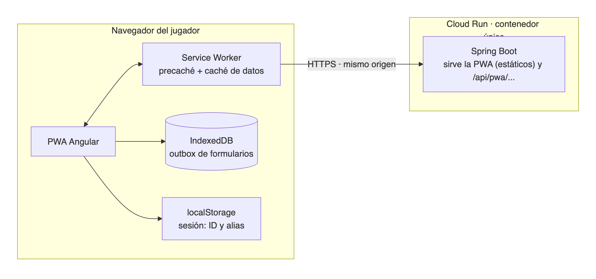

- **Un solo origen.** La PWA consume la API con rutas relativas (`/api/pwa/...`), por lo que no requiere CORS. En la propuesta, el mismo contenedor sirve la PWA y la API; en el laboratorio, Nginx cumple ese papel con un proxy hacia la API. En producción, la PWA se aloja en Firebase Hosting y este reenvía `/api/**` a la API en Cloud Run, de modo que el navegador sigue viendo un solo origen ([10.1](#101-despliegue-en-firebase-hosting)).
- **El Service Worker atiende todas las peticiones** y decide qué responder desde la caché y qué pedir a la red ([7](#7-estrategia-pwa)).
- **Angular moderno:** componentes *standalone* y *signals* para el estado.

### 4.2 Capas del código

El código se organiza en capas; cada una tiene una sola responsabilidad y solo depende de la capa interior.

```
src/app/
├── presentation/      # páginas (landing, búsqueda, expediente, ranking y opinión) y componentes reutilizables
├── application/       # fachadas (casos de uso y estado con signals) y lógica compartida del outbox
├── domain/            # modelos y puertos (interfaces de los repositorios)
├── infrastructure/    # implementación de los puertos: API (repositorios y DTOs), IndexedDB, localStorage, conectividad
├── core/              # configuración común y clasificación de errores HTTP
└── testing/           # dobles de prueba para las pruebas unitarias
```

```
presentation  →  application  →  domain  ←  infrastructure
```

- Las páginas solo hablan con las fachadas.
- Las fachadas usan los **puertos** del dominio (`PerfilRepository`, `PartidaRepository`, `JugadorRepository`, `RankingRepository`, `RetroalimentacionRepository`, `EncuestaRepository`, `OutboxRepository`, `SesionRepository` y `Conectividad`) y no saben si los datos vienen de HTTP, de la caché o de IndexedDB.
- `app.config.ts` enlaza cada puerto con su implementación en `infrastructure`.
- Los estilos son modulares: variables de diseño en `src/styles/tokens.css` y estilos propios en cada componente ([8.4](#84-estructura-modular-y-diseño-adaptativo)).

Recorrido de una consulta:

```
Página → Fachada → Puerto → Repositorio HTTP → /api/pwa/...
Página ← Fachada (signal) ← Modelo ← DTO ←───────┘
```

### 4.3 Fachadas: contrato con la UI

Las pantallas solo usan las fachadas de `src/app/application/facades/`. Todo su estado son *signals* y **nunca lanzan errores**: la pantalla se pinta según `estado()` y muestra `error()`, que ya viene redactado en español. Cada fachada también está documentada con JSDoc en su código.

| Estado        | Cuándo ocurre                                                               | Qué pintar                                                   |
|---------------|-----------------------------------------------------------------------------|--------------------------------------------------------------|
| `INICIAL`     | Todavía no se pidió nada                                                    | La pantalla en reposo                                        |
| `CARGANDO`    | Hay una petición en curso                                                   | Indicador de carga                                           |
| `CON_DATOS`   | Llegaron datos de la red                                                    | La lista                                                     |
| `DESDE_CACHE` | No hay conexión y se muestra la última copia guardada por el Service Worker | La lista con el aviso "Sin conexión" y la fecha `generadoEn` |
| `VACIO`       | La consulta funcionó pero no hay registros                                  | Mensaje de vacío                                             |
| `SIN_RED`     | No hay conexión y no hay nada guardado                                      | Aviso de que se necesita conexión                            |
| `ERROR`       | Falló el servidor                                                           | El mensaje de `error()` y un botón para reintentar           |

**`BusquedaFacade`**: búsqueda por alias o ID.

| Miembro                                   | Uso                                                                                                         |
|-------------------------------------------|-------------------------------------------------------------------------------------------------------------|
| `buscar(texto)`                           | Acepta un ID o un alias de hasta 24 caracteres. Normaliza el texto y una búsqueda nueva cancela la anterior |
| `limpiar()`                               | Vuelve a `INICIAL`                                                                                          |
| `resultados`                              | Lista de `{ jugadorId, alias }`; el alias puede repetirse, por eso el jugador se elige por su ID            |
| `estado`, `error`, `cargando`, `consulta` | Estado de la pantalla, mensaje, bandera de carga y texto normalizado de la última búsqueda                  |

Al elegir un jugador, la pantalla llama a `HistorialFacade.buscar(jugadorId)` y navega a `/perfil`. `/acceso` es el único buscador: `/perfil` no tiene buscador propio, abre el último jugador consultado (`HistorialFacade.jugadorGuardado()`) y, si todavía no se ha consultado ninguno, su guarda (`expediente.guard.ts`) manda a `/acceso`. Si el servidor ya no conoce al jugador guardado (`404`), la fachada lo olvida (`SesionRepository.olvidarJugadorId()`) y marca `jugadorNoEncontrado()`; la página regresa a `/acceso` sin mostrar un error.

**`RankingFacade`**: ranking mundial.

| Miembro                                   | Uso                                                                                                                    |
|-------------------------------------------|------------------------------------------------------------------------------------------------------------------------|
| `cargar()`                                | Primera página; también es el botón "Reintentar". Al volver la conexión se recarga sola: tras `SIN_RED` desde la primera página y tras `DESDE_CACHE` la página que se muestra |
| `irAPagina(n)`                            | Muestra solo la página `n` (de 0 a 4) en lugar de la actual; es el paginador numerado de la pantalla. Si falla, conserva la página que se muestra |
| `verMas()`                                | Agrega las siguientes 10 posiciones; si falla, conserva las que ya se muestran                                         |
| `entradas`                                | Lista de `{ posicion, jugadorId, alias, puntaje, logradoEn }`                                                          |
| `miPosicion`                              | La fila del visitante, solo si ya consultó un perfil (el ID sale de la sesión guardada); puede quedar fuera del top 50 |
| `consultoExpediente`                      | `true` si ya consultó un perfil y ese jugador todavía existe; con `miPosicion` en `null` significa que no tiene victorias. Si la API dice que el jugador guardado ya no existe (404/400), olvida el ID y pasa a `false` |
| `confirmandoJugador`                      | `true` mientras el perfil confirma si el jugador guardado existe; la página no muestra ninguna pista para que no parpadee |
| `hayMas`, `cargandoMas`, `totalElementos` | Paginación                                                                                                             |
| `paginaActual`, `totalPaginas`            | Página que se muestra (desde 0) y cuántas hay (máximo 5)                                                               |
| `generadoEn`                              | Cuándo generó la API los datos; con `DESDE_CACHE` indica la antigüedad de la copia                                     |
| `estado`, `error`, `enLinea`              | Estado de la pantalla, mensaje y conexión                                                                              |

**`EncuestaFacade`**: encuesta anónima. Nunca envía ID ni alias del jugador.

| Miembro                        | Uso                                                                                                                                                                                                                                                     |
|--------------------------------|---------------------------------------------------------------------------------------------------------------------------------------------------------------------------------------------------------------------------------------------------------|
| `enviar(datos)`                | `datos`: `percepcionRiesgo`, `cambioOpinion` y `claridadMensaje` (de 1 a 5) y `comentario` opcional (máximo 500 caracteres). Devuelve `ENVIADO`, `EN_COLA` (guardada en el dispositivo, se envía al volver la red) o `RECHAZADO` (mensaje en `error()`) |
| `enviando`                     | Deshabilita el botón mientras se envía                                                                                                                                                                                                                  |
| `pendientes`, `envios`         | Cuántas respuestas esperan conexión y su detalle                                                                                                                                                                                                        |
| `sincronizar()`, `refrescar()` | Se ejecutan solos al abrir la app y al volver la conexión; `refrescar()` actualiza la lista al abrir la pantalla                                                                                                                                        |

---

## 5. Modelo de datos

La base de datos pertenece a la API; la PWA solo usa algunas tablas.

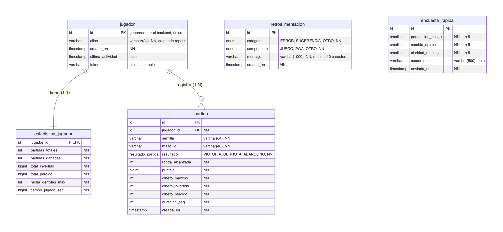

| Tabla                        | Uso en la PWA                                                                                              |
|------------------------------|------------------------------------------------------------------------------------------------------------|
| `jugador`                    | Lectura de `id`, `alias`, fecha de alta y última actividad. La contraseña y el token nunca salen de la API |
| `estadistica_jugador`        | Lectura de las estadísticas del expediente y del ranking                                                   |
| `partida`                    | Lectura del historial                                                                                      |
| `retroalimentacion`          | Inserción. `clave_idempotencia` evita guardar dos veces el mismo envío                                     |
| `encuesta`                   | Inserción anónima. `clave_idempotencia` evita guardar dos veces el mismo envío                             |
| `comodin`, `partida_comodin` | Sin uso por ahora                                                                                          |

El `id` del jugador lo genera la API y es único; el alias se puede repetir. Todas las fechas se guardan en UTC.

---

## 6. Consumo de API

### 6.1 Endpoints

| Endpoint                                    | Uso                                                                                      | Estado          |
|---------------------------------------------|------------------------------------------------------------------------------------------|-----------------|
| `GET /api/pwa/perfil?id=`                   | Datos del jugador y sus estadísticas                                                     | ✅ En uso       |
| `GET /api/pwa/partidas?id=&pagina=&tamano=` | Historial paginado, de la partida más reciente a la más antigua                          | ✅ En uso       |
| `POST /api/pwa/retroalimentacion`           | Envía categoría, componente y mensaje (mínimo 10 caracteres)                             | ✅ En uso       |
| `GET /api/pwa/jugadores?busqueda=`          | Busca por alias o ID (hasta 24 caracteres); devuelve una lista porque el alias se repite | ✅ En uso       |
| `GET /api/pwa/ranking?pagina=&jugadorId=`   | Top 50 en páginas de 10 y la posición propia (`jugadorId` es opcional)                   | ✅ En uso       |
| `POST /api/pwa/encuesta`                    | Encuesta anónima con tres escalas del 1 al 5 y un comentario opcional                    | ✅ En uso       |

Reglas comunes:

- JSON en UTF-8, fechas ISO-8601 en UTC y nombres de campo en español (`camelCase`).
- El ID del jugador viaja en la URL. Es un dato público y así el Service Worker puede usar la URL como llave de la caché.
- Los `POST` llevan la cabecera `Idempotency-Key` con un UUID generado en el dispositivo; si el envío se repite, la API devuelve el registro existente en lugar de duplicarlo.
- Las listas paginadas indican si hay más páginas (`ultima`) y cuándo se generaron (`generadoEn`), para mostrar la antigüedad de los datos sin conexión.
- La API exige la cabecera `X-Api-Key` en todo `/api/**`. La llave es pública: identifica al cliente, no protege datos. En Firebase Hosting la agrega el interceptor de Angular (`api-key.interceptor.ts`), porque el rewrite hacia Cloud Run no puede agregar cabeceras; en local y en Docker también la agrega el proxy. Las escrituras de un jugador (partidas, contraseña) se protegen con su token, y los envíos sin token se protegen con límites de peticiones en la API ([10.1](#101-despliegue-en-firebase-hosting)).

### 6.2 De la respuesta a la lista en pantalla

La infraestructura convierte cada respuesta (DTO) en un modelo del dominio, por ejemplo una partida del historial:

```ts
export interface Partida {
  id: string;
  resultado: 'VICTORIA' | 'DERROTA' | 'ABANDONO';
  rondaAlcanzada: number;
  puntaje: number;
  dineroInvertido: number;
  dineroGanado: number;
  dineroPerdido: number;
  duracionSeg: number;
  creadaEn: Date;
}
```

La fachada del historial guarda las partidas en una *signal* y la página las pinta como tarjetas en el teléfono o como tabla en pantallas grandes. **Ver más partidas** pide la página siguiente y la agrega a la lista hasta que la API indica que es la última.

### 6.3 Respuestas de búsqueda, ranking y encuesta

Así viajan por la red; los repositorios las convierten en modelos del dominio (`JugadorResumen`, `PaginaRanking` y `RespuestaEncuesta`).

```jsonc
// GET /api/pwa/jugadores?busqueda=pez  → lista (el alias puede repetirse)
[{ "jugadorId": "1042", "alias": "pezgordo", "ultimaActividad": "2026-10-13T22:00:00Z" }]

// GET /api/pwa/ranking?pagina=0&jugadorId=1042  → página y posición propia
{
  "pagina": {
    "contenido": [
      { "posicion": 1, "jugadorId": "7", "alias": "ruletero", "puntaje": 1510, "logradoEn": "2026-10-13T22:00:00Z" }
    ],
    "pagina": 0, "tamano": 10, "totalElementos": 50, "totalPaginas": 5, "ultima": false,
    "generadoEn": "2026-10-15T00:43:05Z"
  },
  "miPosicion": null // solo trae datos si el jugador tiene una victoria
}

// POST /api/pwa/encuesta (cabecera Idempotency-Key)  → 201, o 200 con "created": false si la clave ya se usó
{ "percepcionRiesgo": 4, "cambioOpinion": 3, "claridadMensaje": 5, "comentario": "Me hizo pensar" }
{ "id": "9", "created": true, "enviadaEn": "2026-10-14T20:00:00Z" }
```

---

## 7. Estrategia PWA

### 7.1 Manifiesto

[`public/manifest.webmanifest`](public/manifest.webmanifest) permite instalar la PWA en el teléfono o la computadora:

| Propiedad     | Valor                                                                             |
|---------------|-----------------------------------------------------------------------------------|
| Nombre        | "Fat Fish" con el lema "Lo que el casino sabe de ti"; en el ícono solo "Fat Fish" |
| Visualización | `standalone`: se abre como app, sin la barra del navegador                        |
| Íconos        | Logo del juego en 192 × 192 y 512 × 512                                           |
| Colores       | `#0B1416`, el fondo del casino                                                    |
| Idioma        | Español                                                                           |

### 7.2 Service Worker y caché

Se usa el Service Worker de Angular, configurado en [`ngsw-config.json`](ngsw-config.json). Solo se activa en el build de producción y requiere HTTPS o `localhost`.

| Recurso                          | Estrategia                                                                    | Vigencia                    |
|----------------------------------|-------------------------------------------------------------------------------|-----------------------------|
| Código de la app (HTML, JS, CSS) | Precaché al instalar                                                          | Hasta la siguiente versión  |
| Íconos, fuentes e imágenes       | Al primer uso                                                                 | Hasta la siguiente versión  |
| Perfil e historial               | Red primero; si la red falla o tarda más de 5 s, la última respuesta guardada | 7 días, hasta 30 respuestas |
| Ranking                          | Igual que el expediente                                                       | 7 días, hasta 20 respuestas |
| Búsqueda de jugadores            | Igual que el expediente                                                       | 1 día, hasta 20 respuestas  |
| Envíos (`POST`)                  | Sin caché; se usa el outbox                                                   | —                           |

El Service Worker solo guarda lo que ya se pidió, así que al cargar la primera página del ranking con conexión, la fachada pide también las páginas 2 a 5 para dejar el top 50 completo en la caché. La caché distingue cada URL, por lo que el ranking guardado es el del mismo jugador que lo consultó (`jugadorId` forma parte de la URL).

### 7.3 Sin conexión

| Sección           | Comportamiento sin red                                                                                                                                         |
|-------------------|----------------------------------------------------------------------------------------------------------------------------------------------------------------|
| Abrir la app      | Abre desde la precaché                                                                                                                                         |
| Expediente        | Muestra los últimos datos consultados con el aviso "Sin conexión" y su fecha; si nunca se consultaron, avisa que se necesita red                               |
| Ranking           | Muestra la última copia guardada con el aviso "Sin conexión" y su fecha; si nunca se abrió con red, avisa que se necesita conexión. Al volver la red se recarga solo |
| Búsqueda          | Solo repite búsquedas hechas en el último día; si no hay copia, avisa que no hay conexión                                                                      |
| Retroalimentación | Guarda el envío en el **outbox** (IndexedDB) y lo envía solo al volver la conexión                                                                             |
| Encuesta          | Igual que la retroalimentación: la respuesta queda en el outbox y se envía sola al volver la conexión                                                          |
| Menú              | Indica si hay conexión y la fecha de la última sincronización                                                                                                  |

El outbox guarda cada envío con su UUID, su tipo (`retroalimentacion` o `encuesta`), el contenido, el número de intentos y su estado (`PENDIENTE`, `ENVIANDO`, `ENVIADO` o `FALLIDO`). Es el mismo almacén para los dos tipos y cada fachada solo procesa los suyos. Se vacía al abrir la app, en cualquier página, y al recuperar la conexión, con hasta 5 intentos: se reintentan los fallos temporales (sin red, `408`, `429` y errores `5xx`) y un rechazo del servidor, como un `400`, marca el envío como `FALLIDO` sin reintentar. Como el UUID viaja en `Idempotency-Key`, un reintento nunca crea un duplicado.

### 7.4 Segundo plano y actualizaciones

El Service Worker funciona aparte de la página: descarga la app por adelantado y responde las consultas aunque no haya red. La propuesta agrega **Background Sync** para vaciar el outbox aun con la pestaña cerrada (solo existe en navegadores Chromium) y un aviso cuando hay una versión nueva; ambos están pendientes. Las notificaciones push quedan fuera de alcance.

---

## 8. Experiencia de usuario (UI/UX)

La PWA se ve como el casino clandestino del juego: fondo oscuro con un patrón de rombos, paño verde, detalles dorados y letras pixeladas. Colores, fuentes y logo salen del arte del juego en Unity.

### 8.1 Vistas

- **Consulta:** búsqueda por alias o ID (`/acceso`), que es el único buscador, y expediente (`/perfil`: estadísticas e historial, con el botón **Buscar otro jugador**). Cada página tiene su título: *Busca tu expediente* en `/acceso` y *Lo que el casino sabe de ti* en `/perfil`. **Expediente** abre el último jugador consultado o, si no hay ninguno (o ya no existe), el buscador. El ranking mundial (`/ranking`) muestra 10 jugadores por página, hasta 5 páginas, con la posición propia fija abajo si ya consultaste un expediente.
  - La búsqueda lista a cada jugador con su alias y su ID, porque el alias puede repetirse. Si nadie coincide, muestra **Sin resultados** y el Crupier responde con el texto buscado, por ejemplo: *No tengo a nadie llamado «pezgordo». Revisa el alias o dime tu ID.*
- **Captura:** retroalimentación y encuesta anónima, en dos pestañas de la sección Opinión (`/opinion/retroalimentacion` y `/opinion/encuesta`).

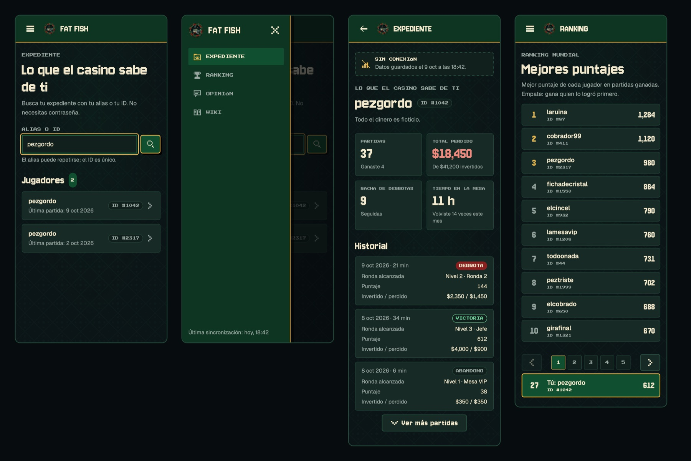

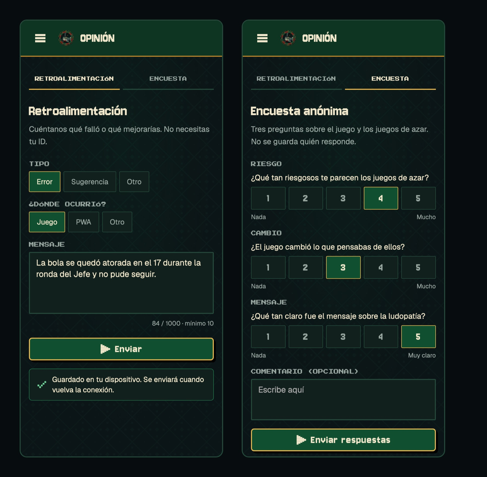

### 8.2 Colores y tipografía

| Uso                                      | Valor                                                                                       |
|------------------------------------------|---------------------------------------------------------------------------------------------|
| Fondo                                    | `#0B1416` con el patrón [`patron-casino.svg`](docs/img/patron-casino.svg)                   |
| Paño (menú y botón principal)            | `#0D3522` y `#105030`                                                                       |
| Dorado (lo importante, foco del teclado) | `#E8B850`                                                                                   |
| Victoria / derrota                       | `#6FD39A` / `#882020`                                                                       |
| Texto                                    | `#F2E8CC` y `#9AA8A2`                                                                       |
| Fuentes                                  | **Jersey 10** (títulos y cifras), **Press Start 2P** (etiquetas cortas) y **Geist** (texto) |

Los textos tienen buen contraste y el resultado de una partida siempre se escribe (VICTORIA, DERROTA, ABANDONO), no se indica solo con color. Las fuentes están en `public/fonts/` para funcionar sin conexión.

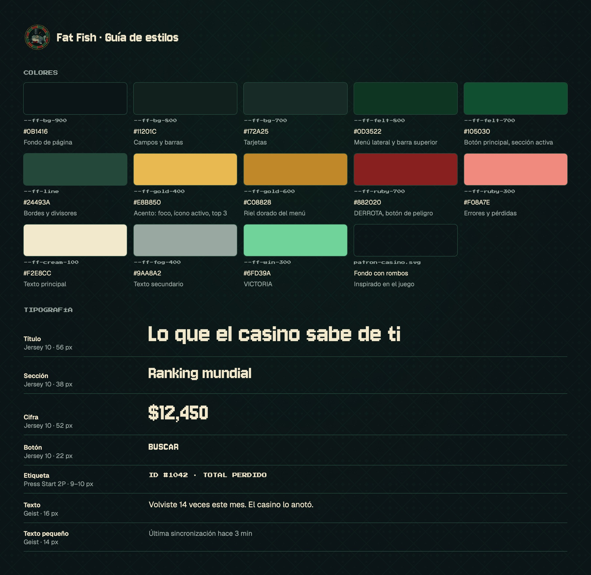

### 8.3 Componentes

La guía define botones, campos, fichas de estado, tarjetas de estadística, historial, menú lateral y avisos de conexión. Los íconos son pixel art de 12 × 12 hecho para la PWA (componente `pixel-icon`) y los controles miden al menos 44 px para tocarse con el dedo.

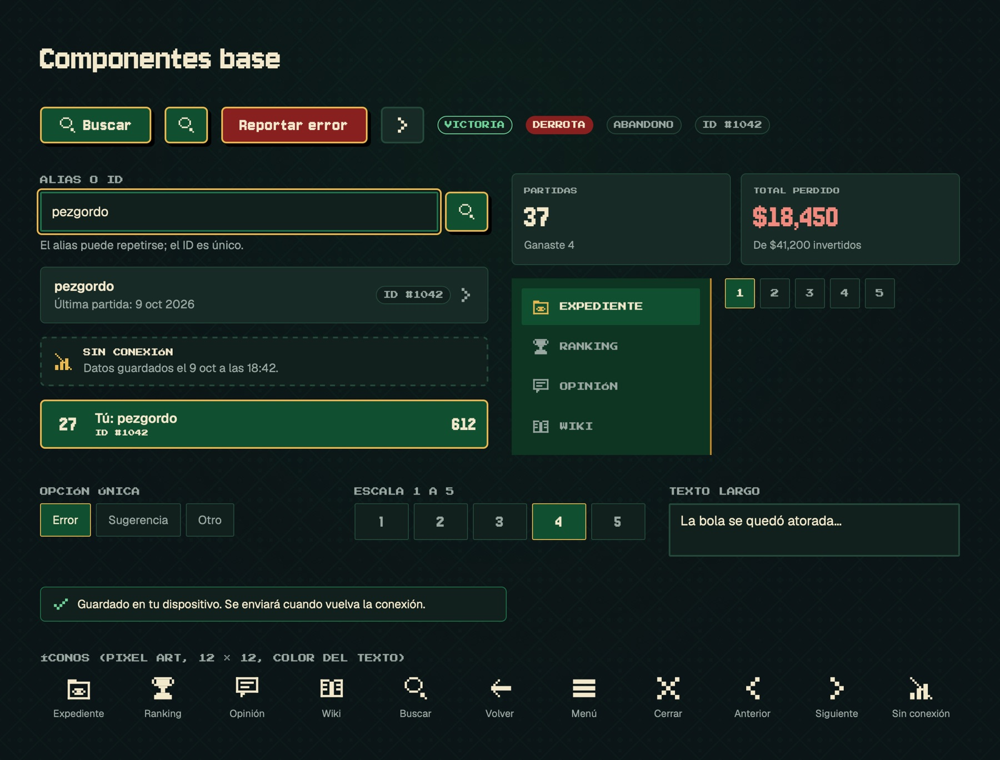

### 8.4 Estructura modular y diseño adaptativo

```
src/styles/
├── tokens.css    # colores, fuentes y espacios (variables --ff-*)
├── base.css      # estilos generales y fondo
└── layout.css    # menú, márgenes y puntos de quiebre
```

Los valores de diseño solo se escriben en `tokens.css`; cada componente tiene sus propios estilos y usa esas variables. El diseño parte del teléfono y se amplía; las tarjetas de estadísticas ocupan tantas columnas como quepan en cada ancho:

| Ancho                  | Cambios                                                         |
|------------------------|-----------------------------------------------------------------|
| Teléfono (< 768 px)    | Menú con el botón ☰ e historial en tarjetas                    |
| Tableta (≥ 768 px)     | Historial en tabla                                              |
| Escritorio (≥ 1024 px) | Menú lateral siempre visible y contenido de 1040 px como máximo |

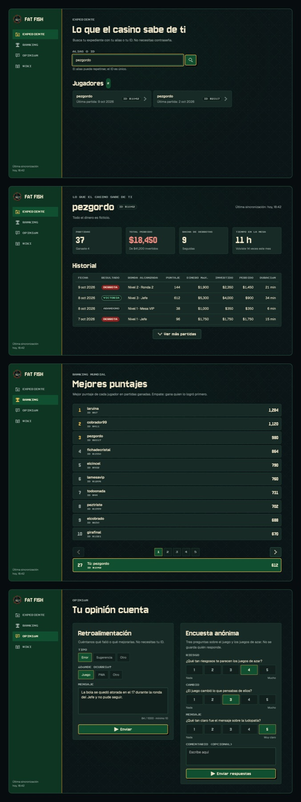

Los textos van en español y de **tú**. El expediente describe hechos sin felicitar, como parte del mensaje sobre la ludopatía.

---

## 9. Diagramas de la aplicación

Los diagramas corresponden a la propuesta completa; su código está en [`docs/diagramas/`](docs/diagramas).

| Diagrama                                             | Qué muestra                                                                                 |
|------------------------------------------------------|---------------------------------------------------------------------------------------------|
| 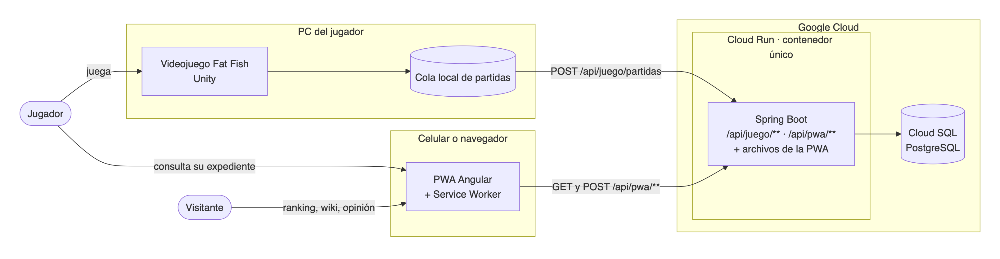             | **Contexto:** cómo llegan los datos del juego a la PWA                                      |
| 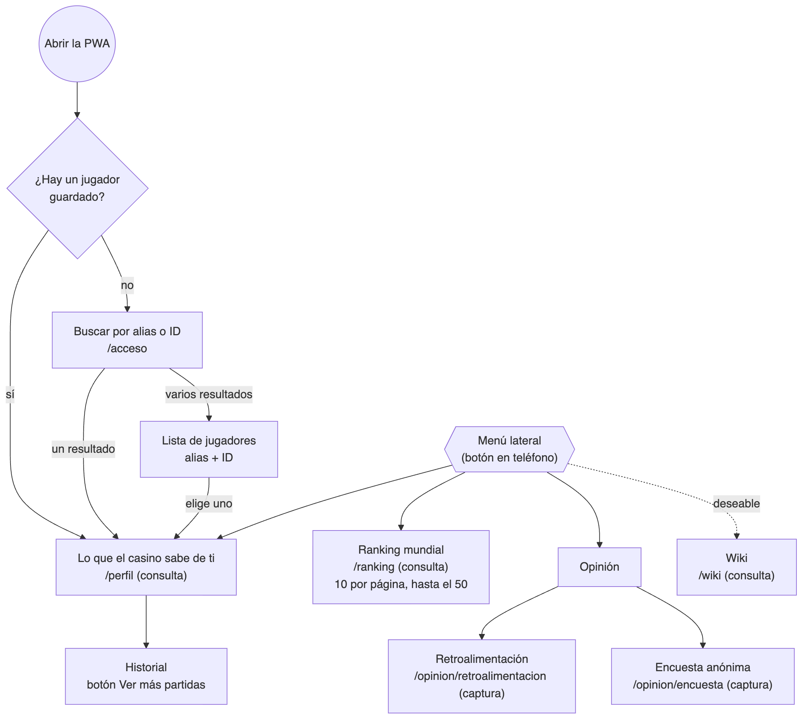         | **Navegación:** rutas de la propuesta; hoy existen `/` (landing), `/acceso`, `/perfil`, `/ranking`, `/opinion/retroalimentacion` y `/opinion/encuesta` |
| 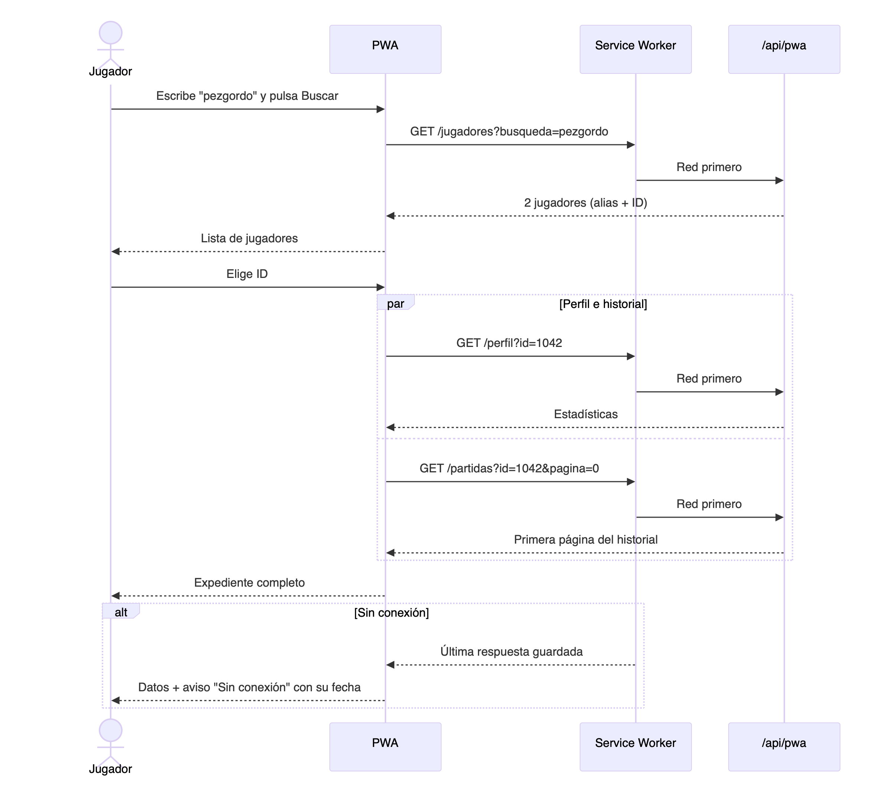             | **Búsqueda:** buscar por alias, elegir un jugador y ver su expediente                       |
| 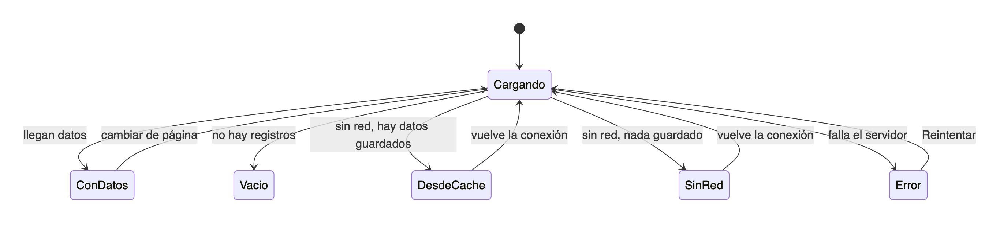               | **Estados de una pantalla:** cargando, con datos, vacío, sin conexión o con error           |
| 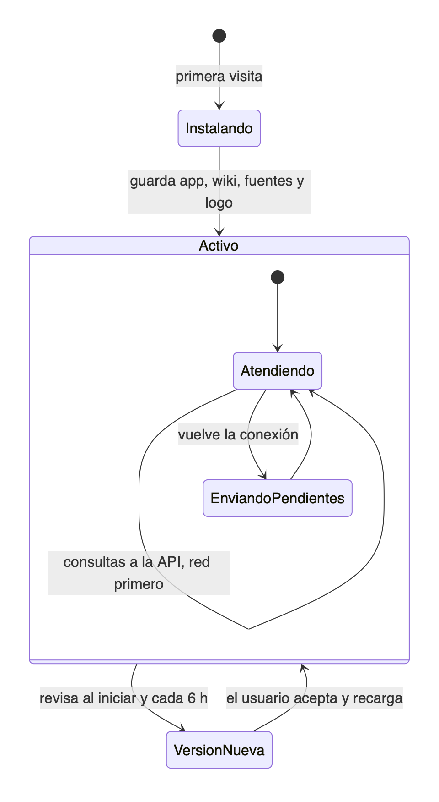 | **Service Worker:** instalación, atención sin red y actualización                           |
| 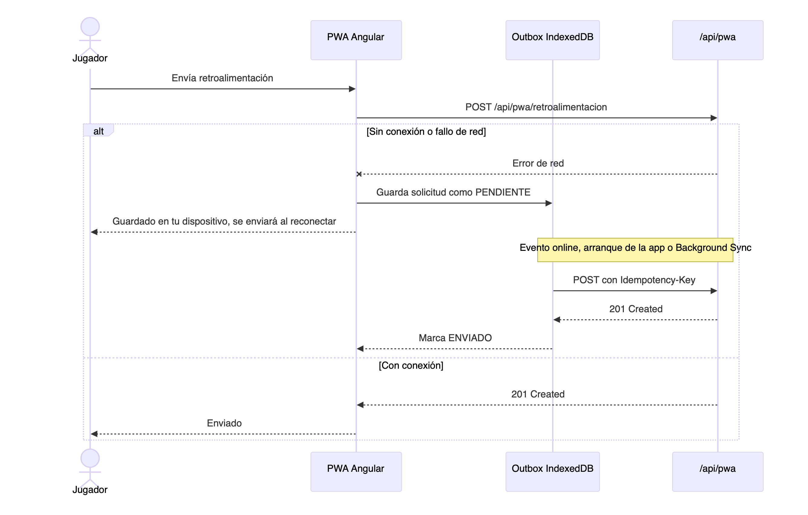                 | **Outbox:** envío de retroalimentación con y sin conexión; la encuesta sigue el mismo flujo |

---

## 10. Integración continua y flujo de trabajo

GitHub Actions ([`ci.yml`](.github/workflows/ci.yml)) corre en cada Pull Request y en cada cambio a `develop` y `main`:

1. **Analizar y probar:** formato del código y pruebas.
2. **Compilar:** build de producción.
3. **Construir imagen Docker:** comprueba que el `Dockerfile` funciona.

Además, [`deploy.yml`](.github/workflows/deploy.yml) publica la PWA en Firebase Hosting cuando un cambio entra a `main` (ver [10.1](#101-despliegue-en-firebase-hosting)).

- Ramas: `main` (producción), `develop` (integración) y `feature/FF-<ticket>-<descripción>`. Las dos principales están protegidas.
- Todo cambio entra por Pull Request con una aprobación y el CI en verde; `CODEOWNERS` asigna a los revisores y la plantilla pide el ticket de Jira.
- Dependabot propone cada semana las actualizaciones de dependencias.

### 10.1 Despliegue en Firebase Hosting

La PWA está alojada en Firebase Hosting de forma pública, en el proyecto `fat-fish-511723` (definido en [`.firebaserc`](.firebaserc)):

| Dirección | Uso |
|---|---|
| <https://fat-fish-511723.web.app> | Dirección principal |
| <https://fat-fish-511723.firebaseapp.com> | Dirección predeterminada alterna (sirve el mismo sitio) |

La configuración del sitio está en [`firebase.json`](firebase.json): sirve `dist/Pwa_FatFish/browser`, reenvía `/api/**` al servicio `fat-fish-api` de Cloud Run (región `us-south1`) y manda el resto de las rutas a `index.html`.

- **Automático:** al fusionar un Pull Request en `main`, el workflow [`deploy.yml`](.github/workflows/deploy.yml) instala dependencias, compila con `npx ng build` y publica en el canal `live`. También se puede lanzar a mano desde *Actions → Deploy → Run workflow*.
- **Secreto requerido:** `FIREBASE_SERVICE_ACCOUNT` (*Settings → Secrets and variables → Actions*), con el JSON de una cuenta de servicio de Firebase. No se sube al repositorio.
- **Manual (solo si hace falta):** `npx ng build` y luego `npx firebase-tools deploy --only hosting`, con la sesión iniciada con `npx firebase-tools login`.
- **Acción fijada por SHA:** `deploy.yml` usa `FirebaseExtended/action-hosting-deploy` por el SHA de su commit y no por la etiqueta `v0`. La acción recibe el secreto de la cuenta de servicio, y una etiqueta la puede mover quien controle ese repositorio; Dependabot propone el SHA de cada versión nueva.
- **Caché:** los `.js` y `.css` con hash se guardan un año (`immutable`). `index.html`, `ngsw.json`, `manifest.webmanifest` y los workers del Service Worker van con `no-cache`, para que una versión nueva llegue de inmediato; esa regla va al final de `headers` porque, si dos reglas fijan la misma cabecera, gana la última.
- **Llave de la API:** viaja en el bundle de Angular, así que es pública por diseño. Los endpoints que escriben sin token (registro, inicio de sesión, retroalimentación y encuesta) quedan protegidos con límites de peticiones en la API (FF-126).

---

## 11. Equipo

**Anuma Games** – Proyecto integrador, grupo IDGS101N, Universidad Tecnológica de Chihuahua

- Luis Ángel Gaxiola Gamboa
- Emmanuel González Hernández
- Jesús Antonio Jiménez Mendoza
- Ángel Gael Jurado Rodríguez
- Andrik Rivera Esquer