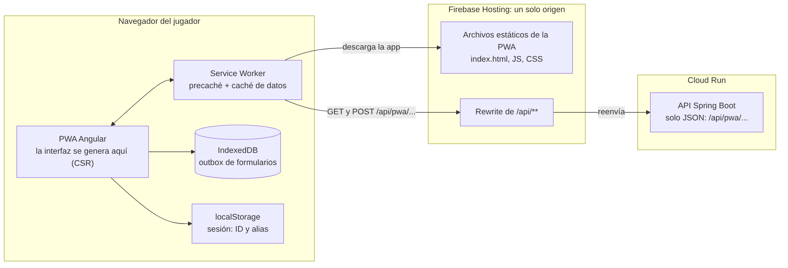

# La PWA y la API de Fat Fish: renderizado e interacción

**Ticket:** FF-170. **Revisado:** 2026-11-22, contra `angular.json`, `app.config.ts`, `app.routes.ts`, `firebase.json`, el Nginx de Docker, `scripts/lab-server.mjs`, los controladores de `fat-fish-api` y un `npx ng build` limpio.

Este documento resume cómo trabaja cada pieza por separado y cómo se comunican. El detalle está en el [README de la PWA](../README.md#44-estrategia-de-renderizado) y en el [README de la API](https://github.com/Anuma-Games/fat-fish-api#readme); aquí no se repite.

## En una frase

La **PWA** es una aplicación Angular que se renderiza en el navegador (CSR) y la **API** es un servicio Spring Boot que solo responde JSON. La PWA no genera datos y la API no genera pantallas.

## Cada una por separado

### PWA (`fat-fish-pwa`)

- **Qué es:** Angular con componentes *standalone* y *signals*, un Service Worker y un manifiesto de aplicación web.
- **Renderizado:** solo en el cliente (CSR). No hay SSR ni prerenderizado: `angular.json` solo define la entrada `browser`, el build crea únicamente `dist/Pwa_FatFish/browser` y el `index.html` compilado trae `<app-root></app-root>` vacío. Es una aplicación de una sola página: cualquier ruta (`/perfil`, `/ranking`...) devuelve el mismo `index.html` y el enrutador de Angular decide qué pantalla pintar.
- **Dónde vive:** como archivos estáticos en Firebase Hosting (`fat-fish-511723.web.app`). Una vez descargada, el Service Worker la guarda para abrirla sin conexión.
- **Qué hace:** muestra el expediente del jugador, el ranking mundial y la búsqueda, y envía retroalimentación y la encuesta anónima. No registra jugadores ni partidas, no maneja contraseñas y no permite jugar.
- **Cómo se organiza:** capas `presentation → application → domain ← infrastructure`. Las pantallas solo hablan con las fachadas; los repositorios HTTP son los únicos que conocen la API.

### API (`fat-fish-api`)

- **Qué es:** Spring Boot con Java, PostgreSQL y migraciones de Flyway. Es el único punto de contacto entre el juego, la PWA y la app móvil.
- **Qué entrega:** solo JSON (`@RestController`; no hay plantillas ni archivos estáticos). No configura CORS porque la PWA la llama desde su mismo origen.
- **Dos grupos de endpoints:** `/api/juego/**` (el juego: registro, sesión, contraseña y partidas, con el token del jugador) y `/api/pwa/**` (la PWA: lectura de datos y envío de opiniones).
- **Dónde vive:** en Cloud Run, con Cloud SQL como base de datos.
- **Controles:** la cabecera `X-Api-Key` identifica al cliente, `Idempotency-Key` evita guardar un envío dos veces y los endpoints sin token tienen límite de peticiones por IP.

## Cómo interactúan

1. El navegador pide la PWA a Firebase Hosting y recibe `index.html`, JS y CSS. Angular arranca y pinta la pantalla.
2. Cuando una pantalla necesita datos, su fachada pide a un repositorio que haga la petición a una ruta relativa (`/api/pwa/...`). El interceptor de Angular agrega `X-Api-Key`.
3. Firebase Hosting reenvía todo `/api/**` al servicio `fat-fish-api` de Cloud Run. Para el navegador sigue siendo un solo origen.
4. La API valida la petición, consulta PostgreSQL y responde JSON (fechas ISO-8601 en UTC, campos en español).
5. El repositorio convierte el JSON en un modelo, la fachada lo guarda en una *signal* y la pantalla se vuelve a pintar. Si la API falla o no hay red, la fachada lo traduce a un estado (`ERROR`, `SIN_RED`, `DESDE_CACHE`...) y la pantalla muestra el aviso que corresponde.

| Pantalla de la PWA                 | Petición a la API                                       | Sin conexión                                   |
|------------------------------------|---------------------------------------------------------|------------------------------------------------|
| Búsqueda (`/acceso`)               | `GET /api/pwa/jugadores?busqueda=`                      | Repite búsquedas del último día                |
| Expediente (`/perfil`)             | `GET /api/pwa/perfil?id=` y `GET /api/pwa/partidas?id=` | Última copia guardada (hasta 7 días)           |
| Ranking (`/ranking`)               | `GET /api/pwa/ranking?pagina=&jugadorId=`               | Última copia guardada (hasta 7 días)           |
| Retroalimentación (`/opinion/...`) | `POST /api/pwa/retroalimentacion`                       | Queda en el outbox y se envía al volver la red |
| Encuesta (`/opinion/encuesta`)     | `POST /api/pwa/encuesta`                                | Queda en el outbox y se envía al volver la red |

### Quién entrega la PWA y reenvía `/api` en cada entorno

| Entorno                     | Entrega la PWA                  | Reenvía `/api` a la API                              |
|-----------------------------|---------------------------------|------------------------------------------------------|
| Producción                  | Firebase Hosting                | Rewrite de `firebase.json` hacia Cloud Run           |
| Docker Compose              | Nginx (puerto 8080)             | `proxy_pass` de Nginx hacia el contenedor `api`      |
| Laboratorio (`npm run lab`) | `scripts/lab-server.mjs`        | El mismo servidor, hacia la API local o de Cloud Run |
| Desarrollo (`npm start`)    | `ng serve` (sin Service Worker) | `proxy.conf.json` hacia `localhost:8080`             |

## Cuándo actualizar este documento

Cuando cambie el modo de renderizado o de despliegue (`angular.json`, `firebase.json`, Nginx), o cuando la API deje de ser solo JSON. En el mismo Pull Request se actualizan la sección 4.4 del README de la PWA y los diagramas `arquitectura` y `contexto`.
